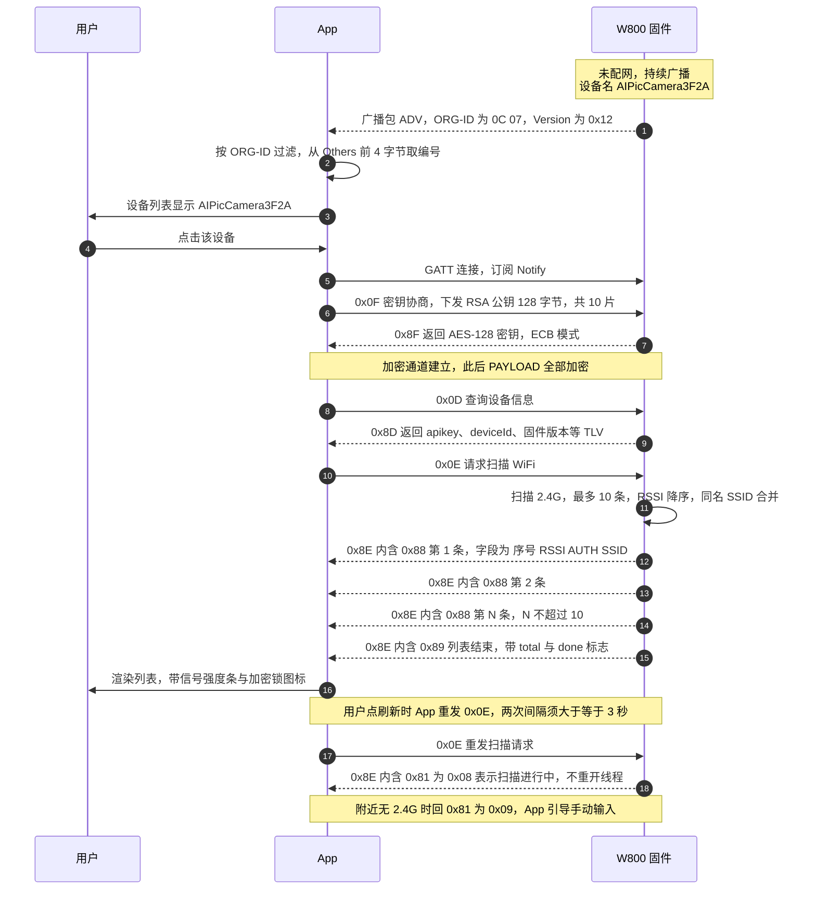
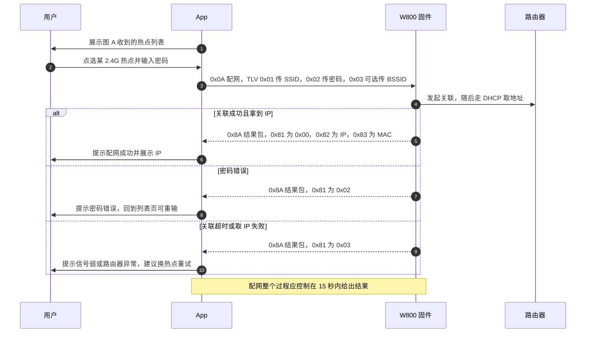
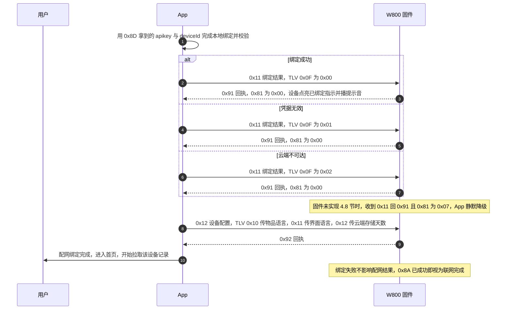

# WM_W800_BleWiFi 蓝牙配网协议

## V1.2（图灵 AI 拍学机扩展修订版）

---

## 📖 修订版阅读说明（请先读这一页）

本文档在联盛德官方 **《WM_W800_BleWiFi 蓝牙配网协议 V1.0》** 基础上，
经 V1.1（身份凭据上报）与 **V1.2（扫描列表式配网）** 两次扩展而成。
**章节编号、章节顺序、表格结构、字段命名全部保持 V1.0 原样**，固件同事无需重新适应文档结构。

所有改动均在原地插入，用以下三种标记区分：

| 标记 | 含义 | 说明 |
|---|---|---|
| 🔴 **【新增】** | 全新内容 | V1.0 中不存在，本次新增 |
| 🟡 **【修改】** | 原地改动 | V1.0 中已有，本次修改其含义或取值范围 |
| 🔵 **【澄清】** | 原文澄清 | 原文表述有歧义或与官方 Demo 实现不一致，此处澄清，**不改协议** |

### 版本沿革

| 版本 | 主题 | 固件必做项 |
|---|---|---|
| V1.1 | 设备身份凭据上报（apikey / deviceId） | `0x8D` 追加 5 个 TLV |
| **V1.2** | **扫描列表式配网**（设备扫 WiFi → App 选 → 下发） | 广播名改名 + `0x8E` 列表格式升级 + 扫描节流 |

### V1.2 改动汇总（共 6 处）

| 序号 | 位置 | 类型 | 改动内容 | 对固件的影响 |
|---|---|---|---|---|
| ① | 3.1 广播包 | 🔴 新增 | 设备名统一为 **`AIPicCamera` + 编号**（如 `AIPicCamera3F2A`） | 必做，改 1 个字符串 |
| ② | 3.1 广播包 | 🟡 修改 | `Others` 字段承载**编号**（4 位 hex），与设备名末 4 位一致 | 必做，1 行代码 |
| ③ | 4.5 扫描 WiFi | 🔴 新增 | 新增 TLV `0x88`（`序号\|RSSI\|AUTH\|SSID` 文本行）与 `0x89`（列表结束） | 必做，**本次核心** |
| ④ | 4.5 扫描 WiFi | 🔴 新增 | 扫描结果**最多 10 条**、按 RSSI 降序、**只报 2.4G**、同名合并 | 必做 |
| ⑤ | 4.9 扫描节流 | 🔴 新增 | 扫描请求**串行化**：扫期中收到新请求回 `0x8E{81:08}`，不得并发新线程 | 必做，**防踩踏** |
| ⑥ | 5 错误码 | 🔴 新增 | 新增 `0x08` 扫描进行中、`0x09` 无可用 AP | 必做，2 个分支 |

**兼容性承诺**：V1.1 全部行为不变。`0x86` 旧列表 TLV **保留并继续发送**，
老 App 仍能解析；新 App 优先读 `0x88`。**不新增命令码**（仍用 V1.0 的 `0x0E`）。

---

### 🎯 一句话说清固件要做什么

**连接后主动扫一次 WiFi，把前 10 个 2.4G 热点按 `序号|RSSI|AUTH|SSID` 的文本行发给 App，
发完补一个「列表结束」TLV。** 广播名改成 `AIPicCamera` + 4 位编号。
其余（密钥协商、`0x0A` 下发、`0x8A` 结果、`0x8D` 凭据、`0x11` 回执）一个字都不用动。

---

### 🖼 交互总时序图（V1.2 全流程）

全流程共 9 步。为便于阅读、也避免单张图过长被截断，拆成 **图 A / 图 B / 图 C** 三张，
按顺序看即为完整链路（**图 A 结尾的扫描列表，就是图 B 的输入**）。

| 图 | 阶段 | 覆盖命令码 |
|---|---|---|
| **图 A** | ① 发现设备 → ② 连接协商 → ③ 扫描 WiFi | 广播 / `0x0F`·`0x8F` / `0x0D`·`0x8D` / `0x0E`·`0x8E` |
| **图 B** | ④ 用户选热点 → ⑤ 下发配网 → ⑥ 设备联网 | `0x0A`·`0x8A` |
| **图 C** | ⑦ 绑定回传 → ⑧ 设备配置 → ⑨ 进入首页 | `0x11`·`0x91` / `0x12`·`0x92` |

**一句话链路（无 mermaid 环境可按此行读）**：
`广播 AIPicCameraXXXX → 0x0F/0x8F 协商 → 0x0D/0x8D 读凭据 → 0x0E/0x8E 扫 WiFi`
`→ 用户点选 + 输密码 → 0x0A/0x8A 配网 → 0x11/0x91 绑定回执 → 0x12/0x92 配置 → 首页`

---

#### 图 A｜发现设备 → 密钥协商 → 扫描 WiFi（V1.2 核心）



---

#### 图 B｜用户选热点 → 下发配网 → 设备联网



---

#### 图 C｜绑定回传 → 设备配置 → 进入首页



> ⚠️ 三张图的**分片、Ack、重传**细节都省略了：每一帧实际都要按 14 字节切片、
> 逐片等 `0x90`/`0x10` Ack，详见 3.2 / 4.7 节。图上只画「逻辑一次请求-响应」。

> 🔴 **关键差异（相对于 V1.0/V1.1 的「App 手输 SSID」）**
>
> | | 旧（V1.0 / V1.1 / 当前 App） | 新（V1.2） |
> |---|---|---|
> | SSID 来源 | 用户在 App 键盘输入 | **设备扫描后上报，用户点选** |
> | 5G 热点 | 用户可能手输 5G SSID → 必失败 | 固件只报 2.4G，**用户选不到 5G** |
> | 密码错误 | 配完才知（`0x8A code=2`） | 同上，但列表已带加密类型，可前置提示 |
> | 隐藏 SSID | 只能手输 | 不支持（不报隐藏 AP） |
> | 扫描并发 | 无此能力 | **必须串行化**，见 4.9 节 |
>
> ---

---

### 文档修改记录

| 版本 | 完成日期 | 修订记录 | 作者 | 审核 |
|---|---|---|---|---|
| V0.1 | 2019/9/25 | [C]创建文档 | Pengxg | |
| V0.2 | 2020/7/8 | 统一字体 | Cuiyc | |
| V1.0 | 2020/8/10 | 升级版本号 | Cuiyc | |
| 🟡 **V1.1** | **2026/10/16** | **图灵 AI 拍学机扩展修订版**：<br>① 4.4 节新增 5 个设备信息 TLV（`0x0A`~`0x0E`）<br>② 4.4 节新增可选绑定结果回传指令（`0x11`/`0x91`）<br>③ 3.2 节澄清 AES 模式为 ECB<br>④ 4.4 节澄清 PAYLOAD 追加语义<br>⑤ 3.2 节澄清分片长度固定 14 字节<br>**兼容性：向后兼容，不新增必选命令码** | **图灵机器人** | **待审** |
| 🔴 **V1.2** | **2026/10/26** | **扫描列表式配网**（由「App 手输 SSID」改为「设备扫、App 选」）：<br>① 3.1 广播名统一为 `AIPicCamera` + 4 位编号<br>② 3.1 `Others` 字段承载编号，与设备名一致<br>③ 4.5 新增 TLV `0x88`（`序号\|RSSI\|AUTH\|SSID`）与 `0x89`（列表结束）<br>④ 4.5 明确「最多 10 条 / RSSI 降序 / 只报 2.4G / 同名合并」<br>⑤ 新增 4.9 扫描节流与并发保护<br>⑥ 5 节新增错误码 `0x08` / `0x09`<br>**兼容性：`0x86` 保留继续发送，老 App 不受影响；不新增命令码** | **图灵机器人** | **待审** |

---

## 目录

| 章节 | 标题 | 本次修订 |
|---|---|---|
| 1 | 引言 | — |
| 1.1 | 概述 | — |
| 2 | 流程 | 🔴 新增 V1.2 时序图 |
| 3 | 帧格式 | — |
| 3.1 | 广播包格式 | 🔴 **新增 ①②** |
| 3.2 | 配置信息包（手机APP -> W800）格式 | 🔵 澄清 ③⑤ |
| 3.3 | 配置结果包（W800 -> 手机APP）格式 | — |
| 4 | 帧内容 | — |
| 4.1 | 配置STA 模式 | — |
| 4.2 | 配置SoftAP 模式 | — |
| 4.3 | 配置STA+SoftAP 模式 | — |
| **4.4** | **查询设备信息** | 🔴 **新增 ①②** 🔵 澄清 ④ |
| **4.5** | **启动设备扫描 WiFi** | 🔴 **重写：新增 ③④** |
| 4.6 | 秘钥协商 | — |
| 4.7 | Ack | — |
| **4.8** | **【新增】绑定结果回传** | 🔴 **新增**（见 4.4 节 ② 的展开说明） |
| **4.9** | **【V1.2 新增】扫描节流与并发保护** | 🔴 **新增 ⑤** |
| 5 | 错误码 | 🟡 新增错误码 ⑥ |
| 6 | GATT 参数 | — |
| 附录 A | 固件实现伪代码 | 🔴 新增 |
| 附录 B | 测试用例 | 🔴 新增 |
| 附录 C | 与 V1.0 差异速查 | 🔴 新增 |
| **附录 D** | **V1.2 固件改动清单一页纸** | 🔴 **新增** |

---

## 1 引言

### 1.1 概述

BleWiFi 是一款基于低功耗蓝牙（BLE）通道，实现WiFi 网络配置功能的协议，适用于W800 芯片。它通过BLE 将WiFi 配置信息和证书等传输给W800，使W800 可以根据这些信息连接到AP 或创建SoftAP。

BleWiFi 支持手机和设备间的秘钥协商，配置信息可采用加密方式传输，是一款安全的配置协议。BleWiFi 支持数据分片、校验和重传，可提高配置效率和保证信息完整性。

🔴 **【新增】** 本修订版（V1.1）在 V1.0 基础上，为**图灵 AI 拍学机**产品形态扩展了「设备身份凭据上报」能力：
设备在配网过程中向 App 上报 **apikey** 与 **deviceId**，App 凭此完成云端绑定与记录拉取。
该能力**完全复用 4.4 节已有的查询指令**，属增量扩展，不影响 V1.0 任何既有行为。

---

## 2 流程

BleWiFi 配置过程主要包括广播、连接、服务发现、秘钥协商、数据传输和 indication 结果等步骤。

```
APP                                    W800
 │                                      │
 │  1.广播                               │
 │◄─────────────────────────────────────│
 │  2.扫描发现设备                        │
 │  3.建立连接                            │
 │──────────────────────────────────────►│
 │  4.秘钥协商（发送公钥）                  │
 │──────────────────────────────────────►│
 │  5.秘钥协商（返回秘钥）                  │
 │◄─────────────────────────────────────│
```

🔴 **【新增】** 以下两步骤为 V1.1 新增，插入在 V1.0 第 5 步与第 6 步之间：

```
APP                                    W800
 │  5.5【V1.1 新增】查询设备信息            │
 │  App 发送 0x0D（V1.0 已有指令，无改动）  │
 │──────────────────────────────────────►│
 │  5.6【V1.1 新增】返回设备信息            │
 │  W800 回复 0x8D，PAYLOAD 追加 5 个 TLV  │
 │  含 apikey / deviceId / org_id / 类型 /  │
 │  固件版本                              │
 │◄─────────────────────────────────────│
 │  ▶ App 本地校验凭据合法性                │
 │  ▶ App 云端校验记录可拉取                │
```

```
 │  5.7【V1.2 新增】启动扫描 WiFi          │
 │  App 发送 0x0E（V1.0 已有指令，无改动）  │
 │──────────────────────────────────────►│
 │  ▶ 固件扫 2.4G，取 RSSI 前 10，去重合并  │
 │  5.8【V1.2 新增】分片上报 WiFi 列表      │
 │  0x8E{0x88 行} × N（序号|RSSI|AUTH|SSID）│
 │◄─────────────────────────────────────│
 │  0x8E{0x89} 列表结束                    │
 │◄─────────────────────────────────────│
 │  ▶ App 渲染列表，用户点选 + 输密码        │
```

```
 │  6.发送配置信息                        │
 │──────────────────────────────────────►│
 │  7.返回配置结果                        │
 │◄─────────────────────────────────────│
 │  8【V1.1 新增·可选】回传绑定结果          │
 │  App 发送 0x11（status=0x00 绑定成功）   │
 │──────────────────────────────────────►│
 │  9【V1.1 新增·可选】绑定结果确认           │
 │  W800 回复 0x91（error=0x00）           │
 │◄─────────────────────────────────────│
```

1. W800 开启GATT Server 功能，发送包含特定信息的广播包。
2. 手机APP 扫描BLE 设备，通过过滤广播包中的特定信息，发现W800 设备。
3. 手机APP 作为GATT Client 和作为GATT Server 的W800 建立连接。

---

## 3 帧格式

### 3.1 广播包格式

格式：

| 0xFF | ORG-ID | Type | Version | Others |
|---|---|---|---|---|

| 0x09 | Name |
|---|---|

其中：

- **ORG-ID**: 蓝牙官网申请的公司的ID，2 字节
  ——联盛德：`0x070C`  客户：自定义
- **Type**：设备的类型（对于客户来讲，区分该设备是哪一系列）。1 字节
  ——联盛德：`0x00`； 客户：自定义
- **Version**：通讯协议版本号。Major&Minor Version。1 字节；
  ——比如 `0x10`，`0x22` 分别代表 1.0 和 2.2 版本。
- **Others**：其他。可以是设备的序列号，或是设备的详细信息等；占用 N 字节；
  ——注意由于广播数据最长 32 字节，不可以超过该限制。
- **Name**：设备名称
  ——建议设备名称以设备 Mac 地址的后 3 个 bytes 结束，保证设备名唯一。

# 🔴 【V1.2 新增 · 必做】设备名与编号统一规则

**原文的「Mac 后 3 字节」建议作废，V1.2 起统一为：**

| 项 | 规则 | 示例 |
|---|---|---|
| 设备名（AD Type `0x09` 与 GAP Device Name 两处都要一致） | `AIPicCamera` + **4 位大写十六进制编号**，中间无分隔符 | `AIPicCamera3F2A` |
| 编号来源 | **设备 MAC 低 2 字节**（`mac[4] << 8 \| mac[5]`），大写 hex，不足 4 位左补 `0` | MAC `…:3F:2A` → `3F2A` |
| 长度 | 固定 **15 字节**（11 + 4），远小于 31 字节上限 | — |
| 字符集 | 纯 ASCII 字母数字，**不得出现中文、空格、`+` 以外的符号** | — |

**为什么用 MAC 低 2 字节**：同一批次烧录的板子 MAC 连续，取低 2 字节可让**同场景内多台设备的编号不重复**
（65536 个空间，一个家庭/教室场景内碰撞概率极低）；且产线无需额外分配号段，
不用建号池、不用烧号，减少一道工序。

**App 侧行为**：直接展示该名称，并在列表中按编号去重（同一编号重复出现时取 RSSI 强者）。
若扫描到 `AIPicCamera` 前缀但编号不是 4 位 hex，App 仍展示但标「未知型号」，不阻断流程。

**兼容性说明（重要）**：
- 老固件（名为 `WM-XXXXXX` 或 MAC 后缀）**不影响功能**：App 仍只按 ORG-ID 过滤，只是列表里显示旧名。
- 现场已有设备**不需要为了改名重新烧片**；改名只在新出厂/新固件批次生效。

**`Others` 字段配套用法**：
广播包 `0xFF` 的 `Others` **前 4 字节填编号的 ASCII**（`33 46 32 41` = `3F2A`），
与设备名末 4 位**必须一致**。App 侧优先信任 `Others`（广播包里 Device Name 有时会缺失或被截断），
`Others` 为空时再退回解析设备名。

**广播包最终布局（示例 `AIPicCamera3F2A`）**：

| 字节 | 值 | 含义 |
|---|---|---|
| `1C` | `0x1C` | 长度 28 |
| `FF` | AD Type 制造商自定义 | — |
| `0C 07` | ORG-ID 小端 | 联盛德 |
| `01` | Type | 图灵 AI 拍学机 |
| `12` | Version | **协议 V1.2**（V1.1 填 `11`） |
| `33 46 32 41` | `3F2A` | 编号（ASCII） |
| `09` | AD Type 短名 | — |
| `41 49 50 69 63 43 61 6D 65 72 61 33 46 32 41` | `AIPicCamera3F2A` | 设备名 |

⚠️ **`Version` 必须随本版改成 `0x12`**，App 据此判断固件是否支持 `0x88` 列表格式；
填 `0x11` 的老固件，App 自动退回按 `0x86` 旧格式解析（见 4.5 节）。

🔵 **【澄清】** `ORG-ID` 在广播包中按**小端序**排列。联盛德 `0x070C` 实际字节序列为 `0C 07`。
App 侧扫描过滤必须按 `0C 07` 匹配，写成 `07 0C` 会扫不到任何设备（此为常见踩坑点，V1.0 原文未注明字节序）。

🔴 **【新增 · 建议】** 建议 `Type` 字段暂用 `0x01` 标识「图灵 AI 拍学机」，便于 App 在多品类设备共存时区分。
此项为**建议值，非强制**，App 侧当前不依赖该字段做过滤（仅依赖 ORG-ID）。

### 3.2 配置信息包（手机APP -> W800）格式

格式：

| Cmd | Sequence | Flag | NO | PAYLOAD | CRC |
|---|---|---|---|---|---|

此包格式包含所有手机APP 发给W800 的包，包含秘钥协商的包。

其中：

- **Cmd**：operation code，占用 1 字节；
- **Sequence**：序列号，1 字节，从 0 开始。帧发送时，序列号自动加 1，用来防止重放攻击 (Replay Attack)。每次重新连接后，序列清零，位溢出后重新从 0 开始。
- **Flag**： 具体含义如下表，

| Bit 位 | 具体含义 |
|---|---|
| [7] | 表示帧是否加密。<br>1 表示加密，0 表示未加密。<br>加密部分仅为 PAYLOAD 域。 |
| [6] | 表示是否要求对方回复 ack。<br>0 表示不要求；1 表示要求回复 ack。 |
| [5] | 表示是否还有下一个帧分片。 |
| [4:0] | 保留。 |

- **NO**：帧分片序号，1 字节， 从 0 开始。如果应用层重传，Sequence 值加 1，NO 不变。
- **PAYLOAD**：消息内容，采用 TLV 封装。
- **CRC**：PAYLOAD 内容值CRC 校验值，1 字节。
  `CRC = CRC8（Cmd+Sequence+Flag+NO+PAYLOAD）`。

🔵 **【澄清 ④ · 极易踩坑】Sequence 是「分片级」序号 —— 一条消息的每一片都要 +1，且发送方必须等写回调才能发下一片。**

这一条从 V1.0 原文"帧发送时，序列号自动加 1"可推出，但与直觉相反（通常协议里"消息序号"是一整条消息共用一个值），
**实测中曾因误解此项导致密钥协商永远超时**，故在此明确。

官方 Android Demo `BleWiFiClient.java` 的原文证据（这是唯一权威依据）：

```java
// 发送：每个分片单独取一个自增的 seq
for (MessagePacket messagePacket : messageEncode.getMessagePacketList()) {
    int seq = mSendSequence.getAndIncrement();   // ← 每片 +1
    messagePacket.buildPacket(seq, mNeedAck);
    if (!gattWrite(messagePacket.packageInfo)) return false;
}

// 接收：同样逐片 +1 并逐片比对
private void handleCharacteristicData(byte[] data) {
    MessagePacket packet = MessagePacket.parsePacket(data);
    if (mRecvSequence.getAndIncrement() != packet.seq) {   // ← 每片 +1
        Log.d(TAG, "Receive invalid sequence!");
        return;
    }
    ...
}
```

因此正确做法是：

| 项目 | 正确做法 |
|---|---|
| 发送序号 | 每发出**一个分片**，seq 自增 1（12 片 RSA 公钥 → seq 依次为 0…11） |
| 接收序号 | 每收到**一个分片**，recvSeq 自增 1 并与该帧 seq 比对，不等则丢弃该帧 |
| 重连 | 收发序号**双双归零** |
| 回绕 | 均按 `& 0xFF` 处理 |

⚠️ **两个连带要点（同样来自官方 Demo，同样容易做错）：**

1. **发送必须「一片一等」**。官方 `gattWrite()` 会阻塞等待 `onCharacteristicWrite` 回调（超时 1000 ms），
   拿到回调才发下一片。若改成"写完休眠几十毫秒再发下一片"，会超出 BLE 协议栈的发送队列深度而**静默丢包**。
2. **无参数的请求也要至少带一个 TLV**。官方 `MessageEncode.serialize800()` 在 TLV 集合为空时
   **直接 `return`**，不产生任何分片 —— 于是 `0x0D`（查询设备信息）这种"不带参数"的指令
   **根本发不出去**。需放一个零长占位 TLV（如 `Type=0x00, Length=0`），设备按未知类型忽略即可。


🔵 **【澄清 ③ · 重要】** **AES 模式为 ECB，不是 CBC。**

V1.0 原文正文中关于加密的描述易被理解为 CBC，但**联盛德官方三端 Demo 源码（Android Java / iOS Objective-C / 微信小程序 JS）实现全部为 `AES-128/ECB/PKCS7Padding`**。
三端代码一致，且与设备端实际行为一致，**以 Demo 代码为准**：

| 项目 | 取值 |
|---|---|
| 算法 | AES |
| 密钥长度 | 128 bit（16 字节，由设备随机生成） |
| **工作模式** | **ECB** |
| 填充 | PKCS7（即 PKCS#5） |
| IV | **无**（ECB 不需要 IV） |

⚠️ **若按 CBC 实现，密钥协商会成功但第一条加密数据就会解密失败，表现为"连上了但配网一直失败"**。这是联调阶段最容易卡死的问题，务必按 ECB 实现。

**涉及范围**：仅 `Flag[7]=1` 的加密帧的 PAYLOAD 部分；明文章景不受影响。

🔵 **【澄清 ⑤ · 重要】** **单帧分片 PAYLOAD 长度固定为 `14` 字节，不随 BLE MTU 变化。**

W800 侧常量 `PACKETMAXLENGTH800 = 14`。**即使协商出的 BLE MTU 更大（如 512），也必须按 14 字节切片**，不得按 MTU 动态调整。
采用固定值是为兼容 W800 内部缓冲区约束。App 侧已硬编码该值，固件侧保持 V1.0 行为即可，**此项无需改动，仅提示勿"优化"**。

🔵 **【澄清】** 密文分片时，每个分片**独立做 PKCS7 填充**后再切片，而非整体加密后切片。
例如 58 字节明文 → 分片加密后每片 16 字节 → 共 5 片（4×14 + 1×2... 实际按 14 字节切片，末片补足），App 侧已按此实现。

### 3.3 配置结果包（W800 -> 手机APP）格式

格式：

| Cmd | Sequence | Flag | NO | PAYLOAD | CRC |
|---|---|---|---|---|---|

此包格式包含所有W800 发给手机APP 的包，包含秘钥协商的包。

其中：

- **Cmd**：response code，值为 operation code + `0x80`。
- **Sequence**：同APP 侧帧格式。
- **Flag**：同APP 侧帧格式。
- **NO**：同APP 侧帧格式。
- **PAYLOAD**：返回消息内容，具体格式参见具体命令。
- **CRC**：同APP 侧帧格式。

🔵 **【澄清】** 最小合法帧长度为 **5 字节**（`Cmd + Sequence + Flag + NO + CRC`，PAYLOAD 为空）。
形如 `0x0D`（查询设备信息）这类"PAYLOAD 和 CRC 内容为空"的指令，其**响应帧 `0x8D` 的 PAYLOAD 可能为空**，
接收侧不可将 5 字节帧判为非法帧丢弃（App 侧已修正此边界）。

---

## 4 帧内容

### 4.1 配置STA 模式

该指令用来配置W800 连接AP 的参数，W800 在收到配置的全部数据后，启动联网操作。

| 0x0A | Sequence | Flag | NO | PAYLOAD | CRC |
|---|---|---|---|---|---|

其中PAYLOAD 内容为TLV 格式：

| TYPE ID | 含义 | 描述 |
|---|---|---|
| 0x01 | AP_SSID | 需要连接的AP 的SSID |
| 0x02 | AP_PASSWORD | 需要连接的AP 的密码 |
| 0x03 | AP_BSSID | 需要连接的AP 的BSSID |

该指令用来将W800 联网结果，通过indication 返回给手机APP。

| 0x8A | Sequence | Flag | NO | PAYLOAD | CRC |
|---|---|---|---|---|---|

其中PAYLOAD 内容为TLV 格式：

| TYPE ID | 含义 | 描述 |
|---|---|---|
| 0x81 | Error_ID | 0x00 成功；<br>0x01 参数错误；<br>0x02 密码错误；<br>0x03 Sta 获取IP 失败； |
| 0x82 | IP_Addr | Sta 连接AP 成功后，获取的IP 地址（4Bytes） |
| 0x83 | MAC | Sta 的Mac 地址 |

✅ **本节点评**：V1.0 原样保留，V1.1 无改动。

### 4.2 配置SoftAP 模式

该指令用来配置W800 创建SoftAP 的参数，W800 在收到配置的全部数据后，创建SoftAp。

| 0x0B | Sequence | Flag | NO | PAYLOAD | 0x00 |
|---|---|---|---|---|---|

其中PAYLOAD 内容为TLV 格式：

| TYPE ID | 含义 | 描述 |
|---|---|---|
| 0x04 | SOFT_AP_SSID | 软AP 的SSID |
| 0x05 | SOFT_AP_PASSWORD | 软AP 的密码<br>*授权模式OPEN 时，不需要设置此参数。 |
| 0x06 | SOFT_AP_MAX_CN | 软AP 的支持的最大连接数<br>*0：表示不限制，由Device 资源决定 |
| 0x07 | SOFT_AP_AUTH_MODE | 软AP 的授权模式<br>0x00：OPEN<br>0x01：WEP64<br>0x02：WEP128<br>0x03：WPA_PSK_TKIP<br>0x04：WPA_PSK_AES<br>0x05：WPA2_PSK_TKIP<br>0x06：WPA2_PSK_AES |
| 0x08 | SOFT_AP_CHANNEL | 工作频道 |

该指令用来将W800 创建SoftAP 结果，通过indication 返回给手机APP。

| 0x0B | Sequence | Flag | NO | PAYLOAD | 0x00 |
|---|---|---|---|---|---|

其中PAYLOAD 内容为TLV 格式：

| TYPE ID | 含义 | 描述 |
|---|---|---|
| 0x81 | Error_ID | 0x00 成功；<br>0x01 参数错误； |
| 0x84 | SoftAP_IP_Addr | 创建SoftAP 成功后，SoftAP 的IP 地址。 |
| 0x85 | SoftAP_MAC | SoftAP 的Mac 地址 |

✅ **本节点评**：V1.0 原样保留，V1.1 无改动。
*注：原文响应侧命令码亦标注为 `0x0B`（应为 `0x8B`），此处按原文保留，属原文笔误，不影响实现——响应帧命令码规则见 3.3 节「operation code + 0x80」。*

### 4.3 配置STA+SoftAP 模式

该指令用来配置W800 创建STA+SoftAP 的参数，W800 在收到配置的全部数据后，启动Sta 联网操作，成功后创建SoftAp。

| 0x0C | Sequence | Flag | NO | PAYLOAD | CRC |
|---|---|---|---|---|---|

其中PAYLOAD 内容为TLV 格式：

| TYPE ID | 含义 | 描述 |
|---|---|---|
| 0x01 | AP_SSID | 需要连接的AP 的SSID |
| 0x02 | AP_PASSWORD | 需要连接的AP 的密码 |
| 0x03 | AP_BSSID | 需要连接的AP 的BSSID |
| 0x04 | SOFT_AP_SSID | 软AP 的SSID |
| 0x05 | SOFT_AP_PASSWORD | 软AP 的密码<br>*授权模式OPEN 时，不需要设置此参数。 |
| 0x06 | SOFT_AP_MAX_CN | 软AP 的支持的最大连接数<br>*0：表示不限制，由Device 资源决定 |
| 0x07 | SOFT_AP_AUTH_MODE | 软AP 的授权模式（取值同 4.2 节） |
| 0x08 | SOFT_AP_CHANNEL | 工作频道 |

该指令用来将W800 创建STA+SoftAP 结果，通过indication 返回给手机APP。

| 0x8C | Sequence | Flag | NO | PAYLOAD | CRC |
|---|---|---|---|---|---|

其中PAYLOAD 内容为TLV 格式：

| TYPE ID | 含义 | 描述 |
|---|---|---|
| 0x81 | Error_ID | 0x00 成功；<br>0x01 参数错误；<br>0x02 密码错误；<br>0x03 Sta 获取IP 失败； |
| 0x82 | IP_Addr | Sta 连接AP 成功后，获取的IP 地址（4Bytes） |
| 0x83 | MAC | Sta 的Mac 地址 |
| 0x84 | SoftAP_IP_Addr | 创建SoftAP 成功后，SoftAP 的IP 地址。 |
| 0x85 | SoftAP_MAC | SoftAP 的Mac 地址 |

✅ **本节点评**：V1.0 原样保留，V1.1 无改动。

---

### 4.4 查询设备信息

# 🔴🔴 本节为 V1.1 核心改动点，请重点阅读 🔴🔴

**改动摘要**
1. 🔴 **【新增】`0x8D` 响应的 PAYLOAD 中追加 5 个 TLV（`0x0A` ~ `0x0E`）**，用于上报 apikey、deviceId 等身份凭据 —— **这是唯一必做的固件改动**。
2. 🔵 **【澄清】新增 TLV 是「追加」而非「替换」**，V1.0 原有 TLV（Error_ID / IP_Addr / MAC 等）保持不变，仍须返回。
3. 🔴 **【新增】`0x0D` 请求指令的 PAYLOAD 仍为空**，App 不发送任何参数，固件按 V1.0 行为处理即可。

**一句话**：指令 `0x0D` 一个字都不改，只改它的响应 `0x8D` —— 在原有 TLV 后面**多追加 5 个 TLV**。

---

该指令用来查询W800 的设备信息。

| 0x0D | Sequence | Flag | NO | PAYLOAD | CRC |
|---|---|---|---|---|---|

其中PAYLOAD 和CRC 内容为空。

🔵 **【澄清】** **此项无改动**。`0x0D` 请求包的 PAYLOAD 依然为空，App 不传参，固件无需解析任何入参。
网络侧收到 `0x0D` 后，直接按 V1.0 逻辑组装 `0x8D` 响应，并在其中追加下述 5 个 TLV 即可。

该指令用来将W800 的设备信息，通过indication 返回给手机APP。

| 0x8D | Sequence | Flag | NO | PAYLOAD | CRC |
|---|---|---|---|---|---|

其中PAYLOAD 内容为TLV 格式，根据W800 当前的模式，分别返回 4.1 配置STA 模式的参数PAYLOAD，4.2 配置SoftAP 模式的参数PAYLOAD，或是 4.3 配置STA+SoftAP 模式的参数PAYLOAD。

🔵 **【澄清 ④ · 重要】「追加」语义说明**

V1.0 原文说 `0x8D` 的 PAYLOAD「根据当前模式，分别返回 4.1 / 4.2 / 4.3 的参数 PAYLOAD」。
V1.1 **不改变这一行为**，而是在其**基础上追加**新的 TLV。即最终 PAYLOAD = **原 V1.0 全部 TLV（原样保留）** + **新增 5 个 TLV（`0x0A`~`0x0E`）**。

固件实现时**不要**因为要返回新 TLV 就把原有的 Error_ID / IP_Addr / MAC 等丢掉。

# 🔴 【新增】以下 5 个 TLV 追加在 `0x8D` 响应的 PAYLOAD 中

| TYPE ID | 含义 | 长度 | 描述 |
|---|---|---|---|
| 🔴 **0x0A** | **APIKEY** | **32 字节** | 设备出厂烧录的 API 密钥，**ASCII 字符串，无终止符**。<br>格式：32 位小写十六进制字符（`[0-9a-f]{32}`）。<br>例：`2cad742e01074214af42d8b7b12b8519` |
| 🔴 **0x0B** | **DEVICE_ID** | **≤ 18 字节** | 设备唯一标识，**ASCII 字符串，无终止符**。<br>实测为 12 位小写十六进制字符。<br>例：`c8586a63e20e` |
| 🔴 **0x0C** | **ORG_ID** | **2 字节** | 芯片厂商 ID，**小端序**。<br>联盛德固定为 `0x070C`，字节序列 `0C 07`。<br>用于 App 二次校验设备来源。 |
| 🔴 **0x0D** | **DEVICE_TYPE** | **1 字节** | 设备类型标识，与广播包 Type 字段含义一致。<br>建议图灵 AI 拍学机填 `0x01`。<br>预留给未来多品类扩展。 |
| 🔴 **0x0E** | **FIRMWARE_VER** | **1 字节** | 固件版本号，**Major(高 4 位) + Minor(低 4 位)**。<br>例：`0x11` = V1.1，`0x23` = V2.3。<br>用于 App 侧做兼容性判断与问题定位。 |

**编码格式总则**（与 V1.0 一致，此处重申）：
- TLV 结构固定为 `Type(1B) + Length(1B) + Value(NB)`
- **Length 字段为 Value 的实际字节数，不含 Type 和 Length 自身**
- **字符串类型一律使用 UTF-8 / ASCII 裸字节，不带 `\0` 终止符**
- **多字节整数除特别说明外一律小端序**
- ERROR 类 TLV（`0x8x`）与设备信息类 TLV 可共存于同一 PAYLOAD

**⚠️ 长度与分片的硬约束（必读）**

新增 5 个 TLV 后，`0x8D` 响应 PAYLOAD 总长约 **+57 字节**（新增示例）：

| 项 | 字节数 |
|---|---|
| TLV 头（Type+Len） × 5 | 10 |
| APIKEY 值 | 32 |
| DEVICE_ID 值 | 12 |
| ORG_ID 值 | 2 |
| DEVICE_TYPE 值 | 1 |
| FIRMWARE_VER 值 | 1 |
| **合计新增** | **58** |

若原有 V1.0 的 TLV 部分约 10~20 字节，加密场景下总长可达 **70~80 字节**。
由于单帧分片上限为 **14 字节**（见 3.2 节澄清 ⑤），**响应帧必然会被拆成 6 片左右**。

**因此固件必须确保：**
1. `Flag[5]`（是否还有下一分片）在多分片时**正确置位**：非末片 = 1，末片 = 0；
2. `NO` 从 **0** 开始**连续递增**；
3. 若请求侧 `Flag[6]=1`（要求 Ack），设备侧需正确响应 `0x90`；
4. 全部分片发送完毕后，等待 App 侧 Ack（若 App 置位了 ack 请求）。

⚠️ **经实测验证**：58 字节明文章景拆为 5 片；加密场景（AES-ECB/PKCS7）下 58 字节 → 64 字节 → 5 片。App 侧的重组逻辑已通过回环测试。

**⚠️ 是否加密由谁决定？**
`0x8D` 响应的 `Flag[7]` **应当与请求 `0x0D` 的加密状态保持一致** —— 即 App 若以加密方式请求，设备亦以加密方式响应。
App 侧当前实现为**发送加密的 `0x0D`**，因此固件需按加密方式响应 `0x8D`
（加密密钥即 4.6 节密钥协商所得 AES-128 密钥，仅加密 PAYLOAD 域，加密模式 **ECB**）。

---

### 4.5 启动设备扫描WiFi

该指令用来控制W800 启动WiFi 扫描，将扫描结果上报给手机APP。

| 0x0E | Sequence | Flag | NO | PAYLOAD | CRC |
|---|---|---|---|---|---|

其中PAYLOAD 和CRC 内容为空。

该指令用来将W800 的WiFi 扫描结果，通过indication 返回给手机APP。

| 0x8E | Sequence | Flag | NO | PAYLOAD | CRC |
|---|---|---|---|---|---|

其中PAYLOAD 内容为TLV 格式：

| TYPE ID | 含义 | 描述 |
|---|---|---|
| 0x81 | Error_ID | 0x00 成功；<br>0x04 扫描失败； |
| 0x86 | WiFi_Scan_Result | WiFi 扫描结果，分多行数据，每行格式为：<br>`SSID,RSSI\r\n` |

# 🔴 【V1.2 重写本节】扫描列表式配网

**本节是 V1.2 的核心改动。** 命令码不变（仍是 V1.0 的 `0x0E` / `0x8E`），
但**响应侧的列表格式做了扩展**，并把「设备扫、App 选」定为标准交互。

### 为什么改

当前 App 让用户**手输 SSID**，实测三个必现问题：

| 问题 | 后果 |
|---|---|
| 用户手输 5G SSID | W800 只支持 2.4G，**必然配网失败**（`0x8A code=3`） |
| 用户拼错 SSID（大小写/下划线） | 失败无提示，只能重来 |
| 隐藏网络 / 中文 SSID | 键盘输入体验极差 |

改为设备扫描上报后，**用户只能从「设备真的看得见的热点」里选**，上述三类失败自然消失。

该交互与图灵蓝牙配网 V1.3（ESP32 线）的 `type2 重扫 + 主动回列表` 语义一致，
详见工单 #2073；本条是把该语义落到 W800 帧格式上。

---

### 4.5.1 触发时机

| 时机 | 谁发起 | 说明 |
|---|---|---|
| 主路径 | **App 发 `0x0E`** | 密钥协商成功后，App 立即请求一次 |
| 用户点「刷新」 | **App 重发 `0x0E`** | 必须遵守 4.9 节节流（间隔 ≥3s） |
| 连接后自动预扫（可选） | 固件自发 | 服务发现完成后先扫一次并缓存，收到 `0x0E` 直接回缓存，可把首屏时间从 ~4s 降到 ~0.2s |

---

### 4.5.2 请求 `0x0E`（App → W800）

| `0x0E` | Sequence | Flag | NO | PAYLOAD | CRC |
|---|---|---|---|---|---|

PAYLOAD **为空**。

> ⚠️ **必须带零长占位 TLV**：按 3.2 节澄清，TLV 集合为空时部分实现不会产生任何分片，
> 导致 `0x0E` 根本发不出去。App 侧固定携带 `Type=0x00, Length=0`，固件按未知类型忽略。

---

### 4.5.3 响应 `0x8E`（W800 → App）

`0x8E` 是一个 **indication 序列**，不是单帧。每次 indication 携带若干 TLV，
由 `0x88` 逐条报 AP，最后由 `0x89` 宣布结束。

| TLV | 名称 | 是否必发 | 出现条件与说明 |
|---|---|---|---|
| `0x81` | Error_ID | 否（仅异常时） | 只在「扫描失败」或「无可用 AP」时出现：`0x00` 成功 / `0x04` 扫描失败 / `0x08` 扫描进行中 / `0x09` 无可用 AP。**正常拿到列表时不发本 TLV** |
| `0x86` | WiFi_Scan_Result（**旧格式，保留**） | 否（可选） | V1.0 原样：`SSID,RSSI\r\n`。**V1.2 起可继续发送**，仅供老 App 使用 |
| 🔴 `0x88` | **WIFI_LIST_V2** | 有可用 AP 时必有 | 每行一个 AP，四个字段以竖线分隔，行间 `\r\n`。**完整行格式见下方代码块** |
| 🔴 `0x89` | **WIFI_LIST_META** | 有可用 AP 时必有 | 2 字节：`total(1B) + done(1B)`。**固定作为整个列表的最后一条发出** |

---

#### TLV `0x88` 行格式（关键）

```
1|-47|3|MyHome_WiFi\r\n
2|-58|2|TP-LINK_5F2A\r\n
...
```

| 字段 | 类型 | 取值 | 说明 |
|---|---|---|---|
| 序号 | 十进制 ASCII | `1` ~ `10` | **1 基**，与 `0x89.total` 对应；一旦发出不得重排 |
| RSSI | 十进制 ASCII，带负号 | `-30` ~ `-100` | dBm，越接近 0 越强 |
| AUTH | 单个数字字符 | 见下表 | 加密方式 |
| SSID | UTF-8 裸字节 | ≤32 字节 | **放在最后**，因此允许含半角逗号、竖线等任何字符 |

**AUTH 取值表**

| 值 | 含义 | App 表现 |
|---|---|---|
| `0` | OPEN（开放网络） | 不弹密码框，直接下发空密码 |
| `1` | WEP | 弹密码框，提示「WEP 已不安全」 |
| `2` | WPA/WPA2-PSK | 弹密码框（最常见） |
| `3` | WPA2-PSK | 弹密码框 |
| `4` | WPA3-SAE | 弹密码框 |
| `5` | WPA2/WPA3 混合 | 弹密码框 |
| `9` | 未知 | 弹密码框，提示「加密类型未知」 |

> 🔴 **SSID 为什么必须放最后**
>
> SSID 按 802.11 规范可以是任意可打印字符（含逗号与竖线），现实中「`ChinaNet-abc,5G`」「`我家 WiFi`」
> 都很常见。若把 SSID 放中间，固件或 App 任一侧按分隔符切分都会切错。
> **放最后 + 前三个字段均为定长可控字符**，解析时只需从左往右数到**第 3 个竖线**（序号、RSSI、AUTH 后面各一个），
> 剩下的整段就是 SSID，**无需转义、无需长度前缀**。
>
> 以 `1|-47|3|MyHome_WiFi` 为例：第 1 个竖线后是 `-47`，第 2 个后是 `3`，第 3 个后是 `MyHome_WiFi`。

---

#### TLV `0x89` 列表元信息

| 偏移 | 长度 | 字段 | 说明 |
|---|---|---|---|
| 0 | 1 | `total` | 本次上报的 AP 条数，`0x00`~`0x0A` |
| 1 | 1 | `done` | `0x01` = 本次列表发送完毕；`0x00` = 还有后续帧 |

> `total` 与「已发出的 `0x88` 行数」必须相等。App 据此判断是否收齐：
> **收齐 = 收到的 `0x88` 行数 == total**。
> 若 `done=1` 但行数不足 → App 重发 `0x0E` 重试一轮（最多 2 次）。

---

### 4.5.4 数量、排序与过滤规则（固件必须遵守）

| 规则 | 要求 | 不合格的后果 |
|---|---|---|
| **数量上限** | 最多 **10 条**，按 RSSI 降序取前 10 | 报太多会导致帧数暴涨、配网超时（参考 #2332：21 个 AP / 690 字节，链路直接压垮） |
| **数量下限** | 少于 10 条时按实际数量报，**不要补空行** | — |
| **频段过滤** | 🔴 **只报 2.4GHz（信道 1~13）**，5GHz 一律丢弃 | W800 不支持 5G，报了用户点了必失败 |
| **同名合并** | 同一 SSID 出现多个 AP（Mesh / 多频），**合并为一条，RSSI 取最强** | 列表里出现 3 个同名热点，用户无法区分 |
| **隐藏网络** | SSID 为空或全 0 的**不报** | 无 SSID 无法展示，用户也选不了 |
| **RSSI 门限** | 低于 **-85 dBm** 的建议不报（弱信号配网成功率低） | 用户选到弱信号，配网超时 |
| **BSSID** | 本版**不报**（App 不需要；`0x0A` 的 `0x03` 仍可选传） | — |

---

### 4.5.5 分片与 Ack 策略

| 项 | 规定 |
|---|---|
| 单 TLV 上限 | `0x88` 每个 TLV **只放一行**（一个 AP），不要拼接多行 |
| 单帧 PAYLOAD | 仍为 **14 字节**（3.2 节澄清 ⑤），一个 `0x88` 通常拆 2~3 片 |
| `Flag[5]`（有后续） | 非最后一帧置 `1`，最后一帧置 `0` |
| `Flag[6]`（要 Ack） | 🔴 **中间帧不置位**；只在含 `0x89` 的**末帧**置位，要求 App 回 `0x10` |
| `Sequence` | 分片级自增，跨整个 `0x8E` 序列连续，**不要每条 AP 归零** |
| 加密 | `0x8E` 的 `Flag[7]` **与请求 `0x0E` 一致**（App 发加密的 `0x0E`，设备就加密回） |

> **为什么中间帧不要 Ack**：10 条 AP 约 25 帧，每帧都等 Ack 会引入 25 次往返，
> 按单次 30ms 算就是 750ms 的纯等待；只在末帧要 Ack 既能确认收齐，又不拖慢列表。

---

### 4.5.6 完整字节示例

假设命中 3 个热点：`MyHome_WiFi`(-47, WPA2)、`TP-LINK_5F2A`(-58, WPA2)、`Cafe-Free`(-66, OPEN)。

```
① 0x8E  0x10 0xE0 0x00   「1|-47|3|MyHome_WiFi」        （分 2 片）
② 0x8E  0x12 0xE0 0x01   「2|-58|3|TP-LINK_5F2A」       （分 2 片）
③ 0x8E  0x14 0xE0 0x02   「3|-66|0|Cafe-Free」          （分 1 片）
④ 0x8E  0x15 0x60 0x03   TLV 0x89 = 03 01              （末帧，置 Ack）
⑤ 0x10  0x00 0x00 0x00   Sequence=0x15                  （App 回 Ack）
```

> 上表中的 `Flag` 值：`0xE0` = 加密(1) + 要后续(1) + 不要 Ack(0)；
> `0x60` = 不加密示例里的末帧写法仅示意，**实际应与请求一致地置加密位 `0x80`**。

---

### 4.5.7 App 侧行为（供固件对齐预期）

| 阶段 | App 行为 | 超时 |
|---|---|---|
| 连接后 | 自动发 `0x0E` | — |
| 等首帧 | 显示「正在获取设备扫描到的 Wi-Fi…」+ 骨架屏 | **15s**（超过则提示重试） |
| 收集中 | 每收到一条 `0x88` 立即插入列表（不等收集完） | — |
| 收齐 | 按 `total` 校验，隐藏骨架屏 | — |
| 未收齐 | 重发 `0x0E`，最多 2 次 | 每次 15s |
| 用户刷新 | 清空列表 + 重发 `0x0E`，**3s 内不可再点** | — |
| 选中 | 开放网络直接下发；其余弹密码框 | — |

> 🔵 **旧格式兼容**：若广播 `Version` 字段（3.1 节）< `0x12`，App 判定为老固件，
> **只解析 `0x86`**（`SSID,RSSI`），此时列表按 RSSI 降序、无加密类型，选中后一律弹密码框。

### 4.6 秘钥协商

手机APP 通过发送该指令，将秘钥协商用的非对称算法公钥传输给W800，此指令不支持加密传输。

| 0x0F | Sequence | Flag | NO | PAYLOAD | CRC |
|---|---|---|---|---|---|

其中PAYLOAD 内容为TLV 格式：

| TYPE ID | 含义 | 描述 |
|---|---|---|
| 0x09 | PUB_KEY | 非对称算法公钥 |

W800 通过发送该指令，将公钥加密的对称算法秘钥返回给手机APP。

| 0x8F | Sequence | Flag | NO | PAYLOAD | CRC |
|---|---|---|---|---|---|

其中PAYLOAD 内容为TLV 格式：

| TYPE ID | 含义 | 描述 |
|---|---|---|
| 0x81 | Error_ID | 0x00 成功；<br>0x01 参数错误； |
| 0x87 | PUB_ENC_KEY | 公钥加密的对称算法秘钥 |

✅ **本节点评**：V1.0 原样保留，V1.1 无改动。**协议层面不变，但实现细节需按下方澄清执行。**

🔵 **【澄清 · RSA 实现细节（App 侧实测）】**

| 项目 | 取值 | 说明 |
|---|---|---|
| 算法 | RSA | |
| 密钥长度 | **1024 bit** | 128 字节密文，**必须一次发完，不能跨分片被截断** |
| **填充模式** | **`RSA/NONE/PKCS1Padding`** | **无摘要的裸 PKCS#1 v1.5** |
| 编码 | 裸二进制字节 | **非** PEM / DER / Base64 |

⚠️ **重点**：公钥（TLV `0x09`）与加密后的密钥（TLV `0x87`）占 **128 字节**，超过单帧 14 字节上限，
**必然被拆为多片传输**（128 / 14 = 10 片）。固件侧需**完整重组后再做 RSA 运算**，不可只取首片。

⚠️ 若固件使用 `RSA/ECB/PKCS1Padding` 等带摘要的模式，会导致解密失败、密钥协商中断。
该值以官方 Demo 为准（三端一致）。

### 4.7 Ack

手机APP 通过发送该指令，响应收到的从W800 返回的包。

| 0x10 | Sequence | Flag | NO | PAYLOAD | CRC |
|---|---|---|---|---|---|

其中Flag 和NO 固定为 `0x00`。
PAYLOAD 内容为 1 个 Byte 的 Sequence 值，与收到的从W800 返回的包的 Sequence 值相同。

W800 通过发送该指令，响应收到的从手机APP 发来的指令包。

| 0x90 | Sequence | Flag | NO | PAYLOAD | CRC |
|---|---|---|---|---|---|

其中Flag 和NO 固定为 `0x00`。
PAYLOAD 内容为 1 个 Byte 的 Sequence 值，与收到的从手机APP 发来的指令包的 Sequence 值相同。

✅ **本节点评**：V1.0 原样保留，V1.1 无改动。
💡 因 4.4 节扩展后响应帧长度增加、分片数变多，**Ack 机制的可靠性会直接影响配网成功率**，建议固件侧确保 Ack 不丢。

---

### 4.8【V1.1 新增】绑定结果回传

# 🔴 本节为 V1.1 全新章节（V1.0 无此节）— 可选实现，但强烈建议

**目的**：App 完成「凭据获取 + 云端记录校验」后，把**绑定结果回传给设备**，设备可据此点亮指示灯 / 播报提示音 / 进入已绑定模式。

**实现要求**：**可选**。若固件不实现，App 侧发送 `0x11` 后会因超时静默降级，**不影响配网与绑定主流程**。

---

App 通过发送该指令，将绑定结果通知给 W800。此指令**必须加密传输**（`Flag[7]=1`）。

| 0x11【新增】 | Sequence | Flag | NO | PAYLOAD | CRC |
|---|---|---|---|---|---|

其中PAYLOAD 内容为TLV 格式：

| TYPE ID | 含义 | 长度 | 描述 |
|---|---|---|---|
| 🔴 **0x0F** | **BIND_STATUS** | 1 字节 | `0x00` = 绑定成功<br>`0x01` = 绑定失败（凭据无效）<br>`0x02` = 绑定失败（云端不可达）<br>`0x03` = 解绑 |

W800 收到后，回复确认：

| 0x91【新增】 | Sequence | Flag | NO | PAYLOAD | CRC |
|---|---|---|---|---|---|

其中PAYLOAD 内容为TLV 格式：

| TYPE ID | 含义 | 描述 |
|---|---|---|
| 0x81 | Error_ID | `0x00` 成功；<br>`0x01` 参数错误；<br>`0x07`【新增】绑定流程未启用（固件未实现本特性） |

**典型交互时序**

```
App                                          W800
 │  0x11 {0F:00}  ← 绑定成功                  │
 │───────────────────────────────────────────►│
 │                                            │  ▶ 点亮"已绑定"指示灯
 │  0x91 {81:00}                              │  ▶ 播报绑定成功提示音
 │◄───────────────────────────────────────────│
```

🔴 **【新增错误码】`0x07`：绑定流程未启用**
固件若**不支持**本节特性，收到 `0x11` 时应回复 `0x91 {81:07}`，
而不是丢弃或返回 `0x01`（参数错误），以便 App 区分「不支持」与「参数错」。

---

### 4.9【V1.2 新增】扫描节流与并发保护

# 🔴 本节是**踩过坑写出来的**，不是理论要求

图灵蓝牙配网 2.0 线上出现过大面积配网失败，定位结果有两条独立根因（工单 #2349 / #2332）：

1. **小程序死循环狂发扫描请求** → 设备侧 WiFi 扫描被反复打断，触发
   「**多线程并发踩踏**」，扫描结果永远凑不齐（#2349 固件日志实证）。
2. **列表包过大 + BLE MTU 停在 23** → 690 字节列表被切成 20 字节碎片，
   每一段都被判「不是合法帧」后丢弃，列表永远回不来（#2332）。

V1.2 的两条必做对策如下，**不做就会重演**。

---

#### 4.9.1 扫描必须串行化（防踩踏）

| 规定 | 要求 |
|---|---|
| 同一时刻只允许**一个**扫描任务 | 用一个 `scan_busy` 标志位保护，不要每次请求都 `xTaskCreate` |
| 扫描进行中收到新 `0x0E` | 🔴 **不要重新起扫**，立即回 `0x8E{0x81:0x08}`（扫描进行中），本次扫描结束后照常上报 |
| 最小重启间隔 | 上次扫描结束到下次启动 **≥3 秒**；不足则回 `0x08` |
| 扫描超时 | 单次扫描（含信道遍历）**≤5 秒**必须结束，超时按 `0x04` 扫描失败上报 |
| 扫描期间 | **不得重启 BLE 广播、不得断开连接**（否则 App 以为设备掉线） |

> **App 侧对 `0x08` 的处理**：不弹错，静默等待 1s 后复用当前列表；
> 若 15s 内始终只有 `0x08`，提示「设备扫描繁忙，请稍后重试」。

---

#### 4.9.2 列表包大小必须可控（防 MTU 碎片）

| 规定 | 要求 |
|---|---|
| 条数上限 | 10 条（4.5.4） |
| 每帧 PAYLOAD | 固定 14 字节切片（既有规定，不要按 MTU 动态调整） |
| 单条 AP 文本 | 建议 ≤ 45 字节（SSID 32 + 前缀 13），**SSID 超 32 字节的按 32 截断** |
| 总量估算 | 10 条 × ~40 字节 ≈ 400 字节 → 加密后约 30 帧 → 按 30ms/帧 ≈ **0.9 秒** |

> **不要用 JSON、不要用长度前缀、不要拼一条大字符串一次发**。
> 文本行 + 逐条 TLV 是刻意的：单条出错只丢一条 AP，不会像 #2332 那样整包报废。

---

#### 4.9.3 扫描失败与空结果的区分

| 场景 | 上报 | App 表现 |
|---|---|---|
| 扫描正常但一个 AP 都没有 | `0x8E{0x81:0x09}` | 「附近没有可用的 2.4G Wi-Fi，请确认路由器已开启 2.4G」+ 刷新按钮 |
| 扫描任务启动失败 / 驱动报错 | `0x8E{0x81:0x04}` | 「设备扫描失败」+ 刷新按钮 |
| 扫描进行中 | `0x8E{0x81:0x08}` | 静默等待（见 4.9.1） |
| 正常（有结果） | 不发 `0x81`，直接发 `0x88` 序列 | 渲染列表 |

🔴 **`0x04` 与 `0x09` 必须分开**：都归成 `0x04` 的话，App 无法告诉用户
「是路由器没开 2.4G」还是「设备扫描坏了」——这两种情况用户的处理动作完全不同。

---

## 5 错误码

| 错误码 | 含义 | 本次修订 |
|---|---|---|
| 0 | 成功 | — |
| 1 | 参数错误 | — |
| 2 | 密码错误 | — |
| 3 | 获取IP 地址失败 | — |
| 4 | 扫描失败 | — |
| 5 | 秘钥交换失败 | — |
| 6 | 发送数据失败 | — |
| 🟡 **7** | 🔴 **【新增】绑定流程未启用** | **V1.1 新增**，仅用于 4.8 节 `0x91` 响应 |
| 🔴 **8** | **【V1.2 新增】扫描进行中** | 仅用于 4.5 节 `0x8E`；**不是错误**，App 应静默等待，见 4.9.1 |
| 🔴 **9** | **【V1.2 新增】无可用 AP** | 仅用于 4.5 节 `0x8E`；扫描成功但无 2.4G 结果，见 4.9.3 |

🟡 **【新增】** 错误码 `7` 为 V1.1 扩展。为使固件版本可被 App 识别，建议在 4.4 节 `0x8D` 响应的
`FIRMWARE_VER`（TLV `0x0E`）中同步标识，例如 `0x11` 表示 V1.1。

🔴 **【V1.2 新增】错误码 `8` / `9` 的语义边界**

| 码 | 是错误吗 | App 该做什么 |
|---|---|---|
| `4` 扫描失败 | 是 | 提示 + 刷新按钮 |
| `8` 扫描进行中 | **否** | 等 1s，复用当前列表；15s 仍无结果才提示 |
| `9` 无可用 AP | 半是 | 提示检查路由器 2.4G，不要提示「设备故障」 |

把 `8` 当错误弹窗，会在用户点快的场景下出现「一闪而过的报错」，是纯体验事故。

---

## 6 GATT 参数

关于 TDS Profile，参见 https://www.bluetooth.com/zh-cn/specifications/gatt

- GATT Service UUID：`0x1824`
- BleWiFi（手机APP -> W800）Characteristic UUID：`0x2ABC`
- BleWiFi（W800 -> 手机APP）Characteristic UUID：`0x2ABC`

✅ **本节点评**：V1.0 原样保留，V1.1 无改动。
**无需新增 Service 或 Characteristic**，读写仍共用 `0x2ABC`，通知方式仍为 indication。

---
---

# 附录 A（V1.1 新增）固件实现伪代码

以下为 C 伪代码，供固件同事参考。**核心逻辑：在 V1.0 已有的 `0x8D` 组装函数中，追加 5 个 TLV。**

## A.1 TLV 写入辅助函数

```c
/* TLV 写入辅助：向缓冲区追加一个 TLV，返回写入后的新偏移 */
static int tlv_put_u8(uint8_t *buf, int off, uint8_t type, uint8_t val)
{
    buf[off++] = type;
    buf[off++] = 1;
    buf[off++] = val;
    return off;
}

static int tlv_put_bytes(uint8_t *buf, int off, uint8_t type,
                         const uint8_t *val, uint8_t len)
{
    buf[off++] = type;
    buf[off++] = len;                    /* Length = Value 字节数，不含 Type/Len */
    if (len > 0) {
        memcpy(&buf[off], val, len);
        off += len;
    }
    return off;
}
```

## A.2 修改 `0x0D` 查询设备信息的响应组装

```c
/* 出厂烧录区读取（示例，实际按产线烧录方案实现） */
extern int credential_read_apikey (uint8_t *out, uint8_t *out_len); /* 32B ASCII */
extern int credential_read_deviceid(uint8_t *out, uint8_t *out_len); /* <=18B ASCII */

#define ORG_ID_WINNERMICRO   0x070C
#define DEVICE_TYPE_TURING   0x01
#define FIRMWARE_VER_V11     0x11   /* Major=1 Minor=1 */

/* 处理 0x0D：查询设备信息 */
static void handle_query_device_info(int seq, uint8_t flag)
{
    uint8_t payload[256];
    int     off = 0;
    uint8_t val[32];
    uint8_t vlen = 0;

    /* ---- ① V1.0 原有逻辑：按当前模式填充 TLV（此处保持不变） ---- */
    switch (current_mode) {
    case MODE_STA:
        /* 原 V1.0 行为：填充 Error_ID / IP_Addr / MAC 等 */
        off = fill_sta_info_tlvs(payload, off);
        break;
    case MODE_SOFTAP:
        off = fill_softap_info_tlvs(payload, off);
        break;
    case MODE_STA_SOFTAP:
        off = fill_sta_softap_info_tlvs(payload, off);
        break;
    }

    /* ---- ② V1.1 新增：追加 5 个身份凭据 TLV ---- */

    /* TLV 0x0A : APIKEY (32B ASCII) */
    vlen = 0;
    if (credential_read_apikey(val, &vlen) == WM_SUCCESS && vlen > 0) {
        off = tlv_put_bytes(payload, off, 0x0A, val, vlen);
    }

    /* TLV 0x0B : DEVICE_ID (<=18B ASCII) */
    vlen = 0;
    if (credential_read_deviceid(val, &vlen) == WM_SUCCESS && vlen > 0) {
        off = tlv_put_bytes(payload, off, 0x0B, val, vlen);
    }

    /* TLV 0x0C : ORG_ID (2B 小端) */
    payload[off++] = 0x0C;
    payload[off++] = 2;
    payload[off++] = (uint8_t)(ORG_ID_WINNERMICRO & 0xFF);         /* 低字节先 */
    payload[off++] = (uint8_t)((ORG_ID_WINNERMICRO >> 8) & 0xFF);  /* 高字节后 */

    /* TLV 0x0D : DEVICE_TYPE (1B) */
    off = tlv_put_u8(payload, off, 0x0D, DEVICE_TYPE_TURING);

    /* TLV 0x0E : FIRMWARE_VER (1B) */
    off = tlv_put_u8(payload, off, 0x0E, FIRMWARE_VER_V11);

    /* ---- ③ 发送响应：加密状态与请求一致，按 14 字节分片 ---- */
    send_response_indication(0x8D, seq,
                             /* encrypted */ (flag & 0x80) ? 1 : 0,
                             payload, off,
                             /* require_ack */ (flag & 0x40) ? 1 : 0);
}
```

⚠️ **注意**：`credential_read_*` 读取失败时**跳过该 TLV**（不写入空 TLV）。
App 侧在收到「无 `0x0A` 或 `0x0B`」时判定为「设备未烧录凭据」，这是预期的错误路径，已妥善处理。

## A.3 发送函数的分片约束（V1.0 行为，重申）

```c
#define PACKETMAXLENGTH800  14   /* ❌ 不可按 BLE MTU 调整，固定 14 */

/* 加密说明：AES-128 / ECB / PKCS7，仅加密 PAYLOAD 域，无需 IV */
```

---
---

# 附录 B（V1.1 新增）测试用例

共 **13 项**，按「必测」与「扩展测」分组。前 6 项为**必测**（直接决定 App 能否配网），后 7 项为**扩展测**。

| # | 级别 | 用例 | 操作 | 预期结果 |
|---|---|---|---|---|
| T01 | **必测** | `0x0D` 空 PAYLOAD 请求 | 发送 `0x0D`，PAYLOAD 空 | 设备正常返回 `0x8D`，不因 PAYLOAD 为空报错 |
| T02 | **必测** | `0x8D` 含 5 个新 TLV | 解析 `0x8D` 响应 | 依次能解析出 `0x0A`/`0x0B`/`0x0C`/`0x0D`/`0x0E` |
| T03 | **必测** | APIKEY 内容正确 | 比对 TLV `0x0A` 值 | 与出厂烧录的 apikey 逐字节一致，长度 32，无 `\0` |
| T04 | **必测** | DEVICE_ID 内容正确 | 比对 TLV `0x0B` 值 | 与云端上报值**同源**，长度正确，无 `\0` |
| T05 | **必测** | 加密响应可解密 | 以加密方式发 `0x0D` | `0x8D` 亦为加密帧，App 用 AES-**ECB** 解密成功 |
| T06 | **必测** | 多分片重组 | 观察 `0x8D` 分片 | `Flag[5]` 正确置位，`NO` 从 0 连续递增，末片 `Flag[5]=0` |
| T07 | 扩展 | 原文 TLV 未被破坏 | 解析 `0x8D` 全文 | Error_ID / IP_Addr / MAC 等**依然存在** |
| T08 | 扩展 | ORG_ID 字节序 | 检查 TLV `0x0C` | 字节序列为 `0C 07`（小端），长度为 2 |
| T09 | 扩展 | 未烧录凭据路径 | 抹除 apikey 后查询 | 跳过 `0x0A` TLV（或主动不返回），`0x8D` 仍合法 |
| T10 | 扩展 | AES 模式为 ECB | 用 CBC 解密 | **必须解密失败**（反证：证明设备确为 ECB） |
| T11 | 扩展 | 明文请求/明文响应 | 以明文方式发 `0x0D` | `0x8D` 亦为明文，`Flag[7]=0` |
| T12 | 扩展 | 绑定结果回传 | 发送 `0x11 {0F:00}` | 回复 `0x91 {81:00}`；未实现则回 `0x91 {81:07}` |
| T13 | 扩展 | 错误码 7 语义 | 未实现 4.8 节时发 `0x11` | 返回 `0x91 {81:07}`，而非 `0x01` |

**测试参数（图灵提供）**

| 项 | 值 |
|---|---|
| Apikey | `2cad742e01074214af42d8b7b12b8519` |
| Secret | `y392wLd44eo272dm` |
| Device ID（有效值） | `c8586a63e20e` ⚠️ |
| 终端ID | `652103447` |
| 云端接口 | `GET https://nglearn.turingapi.com/api/record/list?key=<apikey>&deviceId=<id>&page=1&size=20` |

⚠️ **Device ID 勘误**：客户最初提供的 `c8586a638222` 实测拉不到任何记录，
从云端真实记录反查得到有效值为 **`c8586a63e20e`**。
**请固件侧核对产线烧录值**，并确保 TLV `0x0B` 上报值与云端一致（这是 App 绑定校验的依据）。

---
---

# 附录 C（V1.1 新增）与 V1.0 差异速查

## C.1 差异总表

| 位置 | V1.0 原文 | V1.1 修订 | 标记 | 固件工作量 |
|---|---|---|---|---|
| 3.1 广播包 | 未说明 ORG-ID 字节序 | 澄清为小端 `0C 07` | 🔵 | 无 |
| 3.1 广播包 | Type 客户自定义 | 建议 `0x01` 标识拍学机 | 🔴建议 | 无（可选） |
| 3.2 帧格式 | 加密描述易误解为 CBC | 澄清为 **ECB/PKCS7** | 🔵 | 无 |
| 3.2 帧格式 | 未说明分片长度来源 | 澄清固定 **14 字节** | 🔵 | 无 |
| 3.3 结果包 | 未说明最小帧长 | 澄清为 **5 字节** | 🔵 | 无 |
| **4.4 查询设备信息** | 仅返回 V1.0 模式 TLV | **追加 `0x0A`~`0x0E` 共 5 个 TLV** | 🔴**必做** | **★ 主要工作** |
| 4.4 查询设备信息 | 未明确「追加」语义 | 澄清为**追加非替换** | 🔵 | 无 |
| **4.8 绑定结果回传** | 无此节 | **新增 `0x11`/`0x91` + TLV `0x0F`** | 🔴新增 | 可选 |
| 5 错误码 | 0~6 | 新增 **`7`** = 绑定流程未启用 | 🟡 | 1 行 |

## C.2 固件改动清单一页纸（可直接贴到需求单）

```
【必做】
[ ] 1. 在 0x8D 响应 PAYLOAD 中追加 5 个 TLV：
       0x0A APIKEY        32B ASCII（出厂烧录）
       0x0B DEVICE_ID     <=18B ASCII（出厂烧录，须与云端同源）
       0x0C ORG_ID        2B 小端 = 0C 07
       0x0D DEVICE_TYPE   1B = 0x01
       0x0E FIRMWARE_VER  1B = 0x11
[ ] 2. 确认 0x8D 多分片时 Flag[5] 与 NO 正确（响应会超 14B，必然多片）
[ ] 3. 确认 0x8D 的加密状态与 0x0D 请求一致
[ ] 4. 核对产线 DEVICE_ID 烧录值是否为 c8586a63e20e（非 c8586a638222）

【可选·建议】
[ ] 5. 实现 0x11 / 0x91 绑定结果回传（TLV 0x0F）
[ ] 6. 未实现时，收到 0x11 回复 0x91 {81:07}，而非报参数错误

【无需改动·仅勿"优化"】
[  ] AES 保持 ECB/PKCS7（勿改 CBC）
[  ] 分片长度保持 14 字节（勿按 MTU 调整）
[  ] GATT Service 0x1824 / Characteristic 0x2ABC 不变
```

## C.3 兼容性说明

| 组合 | 行为 | 说明 |
|---|---|---|
| 老固件（V1.0） + 新 App（V1.1） | ⚠️ 配网可用，**绑定失败** | App 收不到 `0x0A`/`0x0B`，判定「未烧录凭据」，提示升级固件 |
| 新固件（V1.1） + 老 App（V1.0） | ✅ 完全正常 | 老 App 忽略未知 TLV，行为与 V1.0 一致 |
| 新固件 + 新 App | ✅ 完整功能 | 全部能力可用 |

**结论**：V1.1 为**向后兼容**的增量扩展，**不破坏任何既有行为**，可安全上线。

---

## 附录 D（V1.2 新增）V1.2 固件改动清单一页纸

附录 C.2 是 **V1.1** 的改动清单；本附录是 **V1.2** 的，两版不重复。
可直接贴进需求单。**按顺序做，前 3 项做完就能联调。**

### D.1 必做项（不做则功能不可用）

| # | 位置 | 改什么 | 验收判据 | 预估 |
|---|---|---|---|---|
| 1 | 广播初始化 | 设备名改 `AIPicCamera` + MAC 低 2 字节（4 位大写 hex） | 手机蓝牙列表里看到 `AIPicCamera3F2A` 这类名字 | 0.5h |
| 2 | 广播包 | `Others` 前 4 字节填编号 ASCII；`Version` 改 `0x12` | 抓包 `1C FF 0C 07 01 12 33 46 32 41 09 …` | 0.5h |
| 3 | WiFi 扫描 | 实现 `0x0E` → 扫 2.4G → 按 4.5.3 发 `0x88` 行 + `0x89` 结束 | App 能收到列表，条数 == `total` | 1.5d |
| 4 | 扫描过滤 | 只留信道 1~13；同 SSID 合并取最强；丢 < -85dBm；丢隐藏 | 列表 10 条以内、无重复、无 5G | 0.5d |
| 5 | 扫描节流 | `scan_busy` 串行化；扫描中收 `0x0E` 回 `0x08`；间隔 ≥3s | 连点 5 次刷新，只起 1 次扫 | 0.5d |
| 6 | 空/失败分支 | 无结果回 `0x09`；驱动失败回 `0x04` | 关掉路由器 2.4G，App 显示「附近没有可用的 2.4G Wi-Fi」 | 0.5h |

**合计 ≈ 3.5 人天**（不含联调）。

### D.2 建议做（提升体验，可后置）

| # | 项 | 收益 |
|---|---|---|
| 7 | 连接后自动预扫并缓存 | 首屏从 ~4s 降到 ~0.2s |
| 8 | 扫描时遍历全部信道（1~13）而非只扫常用 3 个 | 减少漏报，尤其小运营商信道 |
| 9 | 缓存有效期 30s，超时重扫 | 用户停留久了列表不过期 |

### D.3 不要做的事（明确写出来，避免过度设计）

| ❌ 不要 | 原因 |
|---|---|
| 不要发 JSON | W800 拼 JSON 费 RAM；文本行解析更省（#2332 教训） |
| 不要按 MTU 动态切片 | 固定 14 字节是 W800 缓冲区约束（3.2 节澄清 ⑤） |
| 不要报 BSSID / 信道 / 频段 | 本版 App 不消费，纯增加帧数 |
| 不要在中间帧要 Ack | 25 帧各等一次 Ack = 多 750ms |
| 不要为了改名动已出厂设备 | 名字只影响展示，App 靠 ORG-ID 过滤 |
| 不要把 `0x08` 当错误上报 UI | 用户点刷新就会出现「一闪而过报错」 |

### D.4 联调自检清单

| # | 步骤 | 期望 |
|---|---|---|
| 1 | 上电，手机蓝牙搜索 | 见 `AIPicCameraXXXX`，与设备贴纸编号一致 |
| 2 | 连接 → 密钥协商 | 日志 `0x8F Error_ID=0` |
| 3 | 发 `0x0E` | 3s 内收到首条 `0x88` |
| 4 | 收全 | 行数 == `0x89.total`，`done=1` |
| 5 | 选 2.4G + 输密码 → `0x0A` | 15s 内 `0x8A{81:00}` + 拿到 IP |
| 6 | 选 5G 热点 | 列表里**根本不应出现** |
| 7 | 连点刷新 5 次 | 仅 1 次真实扫描，其余回 `0x08`，App 不报错 |
| 8 | 关 2.4G 路由器后刷新 | `0x09`，文案为「附近没有可用的 2.4G Wi-Fi」 |
| 9 | 密码故意输错 | `0x8A{81:02}`，App 提示密码错误并可重试 |
| 10 | 全套走完 | `0x11`/`0x91` 正常，App 进入首页 |

### D.5 与 V1.1 差异速查

| 项 | V1.1 | V1.2 |
|---|---|---|
| 设备名 | `建议 MAC 后 3 字节` | **`AIPicCamera` + 4 位编号（强制）** |
| 广播 Version | `0x11` | **`0x12`** |
| `Others` | 未定义 | **编号 4 字节 ASCII** |
| 扫描列表 TLV | 仅 `0x86`（SSID,RSSI） | **`0x88`（含 AUTH）+ `0x89`（total/done）** |
| 条数/排序 | 未规定 | **≤10 条、RSSI 降序** |
| 频段 | 未规定 | **只报 2.4G** |
| 并发保护 | 无 | **4.9 节强制串行化** |
| 错误码 | 0~7 | **+8 扫描中 / +9 无可用 AP** |
| 命令码 | — | **不新增**（仍 `0x0E`/`0x8E`） |

---

## 附：本次修订背景

| 项 | 说明 |
|---|---|
| 修订起因 | **V1.1**：App 配网需获取设备 `apikey` + `deviceId`，以完成云端绑定与单词卡记录拉取。<br>**V1.2**：把「App 手输 SSID」改为「设备扫描上报 → 用户点选」，消除手输 5G / 拼错 SSID / 中文 SSID 三类必现失败，并对齐图灵蓝牙配网 V1.3 的交互语义（#2073）。 |
| 修订原则 | ① 不新增必选命令码 ② 不新增 GATT 特征 ③ 不改广播包结构（仅改内容取值） ④ 不破坏既有行为 ⑤ 单点失败不拖垮整包（逐条 TLV 而非大 JSON） |
| 方案选型 | V1.1 复用 `0x0D`/`0x8D` 追加 TLV 承载凭据；V1.2 复用 `0x0E`/`0x8E`，新增 `0x88`/`0x89` 两个 TLV，`0x86` 继续发送以兼容老 App |
| 依据来源 | 联盛德官方《WM_W800_BleWiFi 蓝牙配网协议 V1.0》+ 官方三端 Demo 源码（Android Java / iOS OC / 微信小程序 JS）+ 图灵云端接口实测 + 图灵配网线上故障复盘（#2332 MTU 碎片、#2349 扫描并发踩踏、#2073 V1.3 双协议） |
| 修订单位 | 北京光年无限科技有限公司（图灵机器人） |
| 配套文档 | `固件端协议扩展规格书_V1.0.md`（详细实现指引）、`拇指相机App技术方案_V1.0.md`（三端技术方案） |

---

*—— 文档结束 ——*
