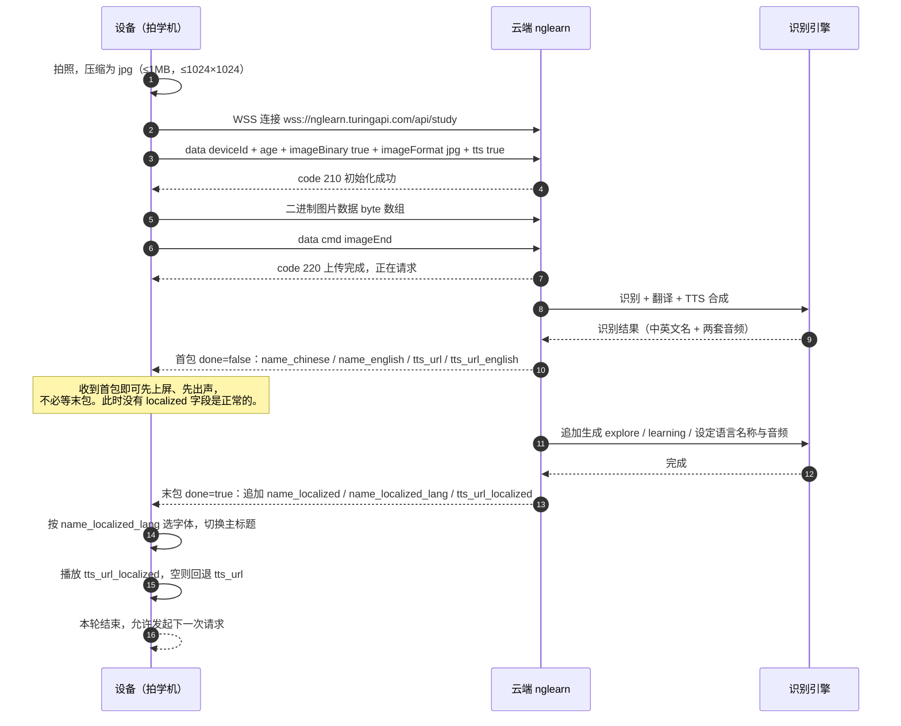
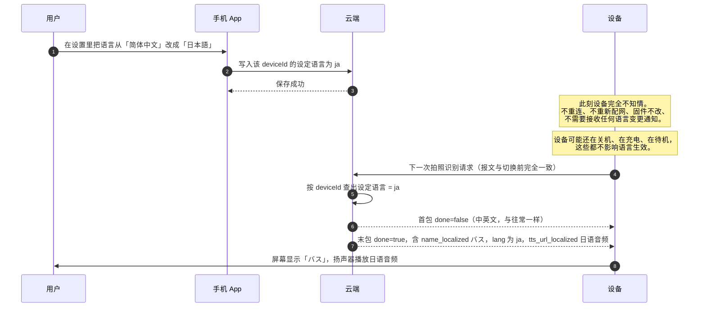
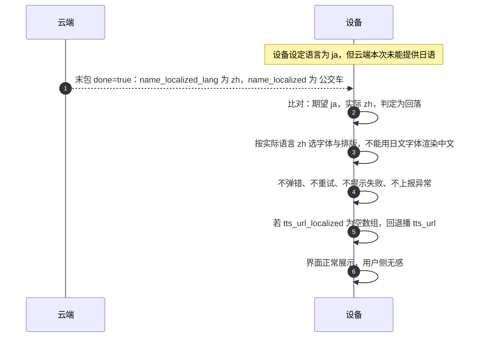
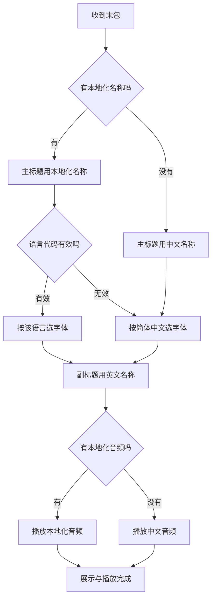

# AI 拍学机接口接入说明文档 V3.1

> **基线**：《图灵AI拍学机接口接入说明文档_V3.0_2025.10.23》
> **本版定位**：多语言能力升级版。**只加返回字段，不动请求结构**。
> **标注约定**：🔴 新增 ｜ 🟡 修改 ｜ ⬜ 不变。全文可直接替换 V3.0 使用。

---

## 0. 本次升级一页纸（建议先看这一页）

### 0.1 一句话概括

拍学万物接口在**最终返回包**里多给 3 个字段，让设备能显示并朗读「用户设定语言」的物品名称。
**请求侧一个字都不改**，加密、域名、上传流程、状态码全部不变。

### 0.2 设备侧到底要改什么

| 项 | 设备要不要改 | 说明 |
|---|---|---|
| 请求报文 / 入参 | **不用改** | 不新增语言参数，报文与 V3.0 完全一致 |
| 图片上传流程 | **不用改** | `imageBinary` / `imageEnd` 流程不变 |
| 加密方式 | **不用改** | AES / CBC / PKCS5 / 16 位密钥规则不变 |
| 域名 / 连接方式 | **不用改** | 仍是 `wss://nglearn.turingapi.com/api/study` |
| 状态码处理 | **不用改** | 不新增任何状态码 |
| 绑定 / 配网 / 设备配置 | **不用改** | 与本接口无关 |
| **解析返回字段** | **要改** | 增加 3 个字段的解析与兜底 |
| **屏幕显示逻辑** | **要改** | 主标题优先用 `name_localized`，按 `name_localized_lang` 选字体 |
| **音频播放逻辑** | **要改** | 优先播 `tts_url_localized`，空则回退 `tts_url` |
| **字体资源** | **要改** | 需覆盖 9 种语言的字形（细节见 2.5） |

> 结论：**接口零改动，端上零风险**。改动集中在设备端的「显示 + 播放」两个模块，工作量约 2~3 人天。

### 0.3 三个必须记住的约束

1. **设备永远不需要上报语言**。语言是 App 写入云端的，云端按 `deviceId` 匹配，设备下一次请求自然拿到新语言的结果。
2. **`name_localized_lang` 必须按「实际返回的语言」判断，不能按「期望的语言」判断**。云端可能回落，回落时 `code` 仍是 `200`，不是错误。
3. **历史记录不回溯**。切语言只影响之后新拍的卡，已存档的旧记录不会被重算（见 2.5.4）。

---

## 文档修订记录

| 文档版本号 | 修订日期 | 修订原因 |
|---|---|---|
| V1.0 | 2025.02.21 | 创建文档 |
| V1.1 | 2025.02.25 | 接口增加图片 base64 及图片流式输入 |
| V1.2 | 2025.03.13 | 增加协议加密流程；入参增加 data 层级，uid 字段更新为 deviceId |
| V1.3 | 2025.03.20 | ASR 增加支持 OPUS，SPEEX 音频格式输入 |
| V1.4 | 2025.03.27 | 接口返回数据中增加物品音频输出 |
| V1.5 | 2025.04.18 | 增加协议异常 code 说明；对话世界接口增加成人场景支持 |
| V1.6 | 2025.04.28 | 优化拍学万物与对话世界接口返回的 TTS 的数据结构 |
| V1.7 | 2025.05.22 | 对话世界接口新增 clientRequestId 及 type 字段，优化 text 字段 |
| V1.8 | 2025.05.29 | 优化接口 |
| V2.1 | 2025.07.03 | 拍学万物接口新增 clientRequestId 字段，首包增加英文单词及音频 |
| **V3.1** 🔴 | **2026.10.26** | **拍学万物接口返回新增「设定语言」名称与音频（支持 9 种语言，含繁体）；请求侧、对话世界接口、状态码全部不变** |

---

## 1. 产品介绍 ⬜ 不变

AI 拍学机是一款面向儿童的智能学习产品，专为 3-12 岁儿童设计，结合生成式 AI 与多模态 AI 技术，为儿童提供丰富的学习、探索、娱乐类互动。本产品旨在通过拍照交互的方式，激发儿童的学习兴趣，为其提供个性化的教育支持，帮助儿童无痛学习，拓展知识。产品的核心功能包括知识获取、角色对话、趣味故事生成等，旨在激发儿童对周围世界的探索和学习兴趣，同时满足 3-6、7-9、10-12 岁不同年龄段儿童的认知需求。

### biz 后台账号申请 ⬜ 不变

```
后台地址：http://biz.turingos.cn/
申请 WebSocket 接入方式的 apikey
```

---

## 2. 拍学万物接口

拍一拍，探世界，此接口支持识别物体。能分辨物品类型，图片中若物品单一，输出单个物品名称；物品不单一，输出图像中最突出/面积最大的物品名称。

注意：接口无法分辨的物品，eg：输出整个场景的中文名称。

### 2.1 域名地址 ⬜ 不变

```
正式环境地址：wss://nglearn.turingapi.com/api/study
```

### 2.2 接口说明

#### 2.2.1 数据加密方式 ⬜ 不变

为保证接口的安全性和稳定性，可对接口数据进行加密。

```
加密模式  CBC
填充      PKCS5Padding
数据块    128 位（密钥为 16 位）
输出      base64 编码字符串
编码      utf-8
密钥      Accesskey + 密钥管理页 Secret + 入参 timestamp 拼成字符串 str
          → 对该字符串取 16 位小写 md5 值
注：偏移量字符串等于密钥
```

加密参考页面：http://tool.chacuo.net/cryptaes

#### 2.2.2 初始化参数 🟡 只新增一段说明，**参数表完全不变**

加密请求示例如下：

```json
{
  "key": "ak_01jwdhtefw*****ash9js28cs",
  "timestamp": "150******7793",
  "data": "加密后的内容"
}
```

注意：选择加密后，`data` 字段下的数据均需要加密处理。

未加密请求示例如下：

```json
{
  "key": "ak_01jwdhte*****aash9js28cs",
  "timestamp": 1740046130936,
  "data": {
    "deviceId": "1234789",
    "age": 10,
    "imageUrl": "http://book-iot.oss-cn-beijing.aliyuncs.com/book_qa_biz/beta/51e3dce88e4745cca7d9133b09b3a84f.jpg",
    "imageFormat": "jpg",
    "functions": ["explore", "learning"],
    "tts": false,
    "ttsPrefix": false,
    "clientRequestId": ""
  }
}
```

**请求参数说明 ⬜ 不变**

| 参数 | 类型 | 是否必须 | 说明 |
|---|---|---|---|
| key | String | Y | 平台应用中的 Accesskey |
| timestamp | String | Y | 时间戳（ms） |
| data | JSON | Y | 配置信息，参考下方参数 data 字段说明 |

**data 字段说明 ⬜ 不变（V3.1 不新增任何入参）**

| 字段 | 必须 | 类型 | 说明 |
|---|---|---|---|
| deviceId | Y | string | 用户/设备 id，字母/数字组成，长度不超过 18 |
| age | Y | int | 年龄 3-12，3~6 / 7-9 / 10-12 分为三个阶段，分别为学前儿童、小学低段、小学高段 |
| imageUrl | N | string | 图片 url，入参方式三选一 |
| imageBase64 | N | string | 图片 base64，入参方式三选一 |
| imageBinary | N | boolean | 是否传输二进制图片，默认否，入参方式三选一。如果这个值设置为 `true`，需要一起执行【2.2.3 上传图片数据】【2.2.4 上报传输图片数据结束标识】 |
| imageFormat | Y | String | 图片格式，目前仅支持 jpg，jpeg，png 格式图片 |
| functions | N | list | 取值 `explore`，`learning`。`explore`：关系探索；`learning`：多维学习。此为可选功能，不传默认未选 |
| tts | N | boolean | 是否输出 tts 结果，默认否 |
| ttsPrefix | N | boolean | 如果输出 tts 结果，是否增加"这是"前缀，此前缀只针对 tts 有效 |
| clientRequestId | N | String | 不大于 32 个字符，客户请求唯一 ID，输出时会携带该参数 |

注意：

> 1. 图片入参方式支持图片 url、图片 base64、图片二进制流，三选一。
> 2. 关于图片格式及大小：仅支持 png、jpg、jpeg；图片大小不超过 1M；分辨率最大 1024×1024px，建议小于 1024×1024，推荐图片大小 200k 左右效果较好。

---

##### 🔴 新增说明：关于「设定语言」（V3.1 核心，请务必读完）

> **设定语言**指「识别结果按哪种语言返回、用哪种语音合成音频」，由用户在手机 App 上选择。
>
> **设备不需要在请求中携带任何语言参数，也不需要在本地保存语言设置。** 语言的存储与匹配全部在云端完成，云端按 `deviceId` 关联。
>
> 用户在 App 改完语言后，设备**下一次请求**拿到的即为新语言的结果与音频。设备不需要被通知、不需要重连、不需要重新配网、固件不需要为此增加任何命令。
>
> 设定语言**只影响** 2.3 中新增的 `name_localized` / `name_localized_lang` / `tts_url_localized` 三个字段。`name_chinese`、`name_english`、`tts_url`、`tts_url_english` 的含义与取值**保持不变**，仍然固定返回中文与英文。

**三种典型情况：**

| 场景 | 设备会看到什么 |
|---|---|
| 用户从未设置过语言 | `name_localized` = 中文，`name_localized_lang` = `zh` |
| 用户设成日语，云端正常出力 | `name_localized` = `バス`，`name_localized_lang` = `ja` |
| 用户设成某语言，但云端本次未能提供 | 回落到中文，`name_localized_lang` = `zh`（**不是报错，`code` 仍为 200**） |

#### 2.2.3 上传图片数据（`imageBinary=true` 时）⬜ 不变

初始化成功后，上传图片 `byte[]` 数据，二进制输入。

#### 2.2.4 上报图片数据结束标识（`imageBinary=true` 时）⬜ 不变

未加密请求示例：

```json
{
  "key": "ak_01jwdhte*****aash9js28cs",
  "timestamp": 1740046130936,
  "data": {
    "cmd": "imageEnd"
  }
}
```

请注意：结束上传图片二进制流时，需要给云端发送上面的消息。

### 2.3 返回数据示例及参数说明 🟡 新增 3 个字段，其余不变

#### 2.3.1 返回示例 result-1（首包）⬜ 不变

```json
{
  "clientRequestId": "12356458",
  "code": 200,
  "data": {
    "name_chinese": "公交车",
    "name_english": "Bus",
    "tts_url": [
      "http://turing-iot-tts-oss.turingapi.com/tts/third/tts-433d85a0e78a44c685453e22b2056d5a.mp3"
    ],
    "tts_url_english": [
      "http://turing-iot-tts-oss.turingapi.com/tts/third/tts-fcf5f64d5dce422f8ed4956999e0c6ac.mp3"
    ]
  },
  "done": false,
  "globalId": "960b68312a694c4e953e5c6753ee8506_f4d5321a3e169d85948b7e688b2c802c_c6df910067c105f5_add7b1a3d55fd1ccdb4067d94627b6fd_dd7ff4d88354a25e_50be56a6aa75486b1502520387eb4bb6_d2c8f6e6f1a9c726",
  "message": "success"
}
```

> **首包里没有 `name_localized`**，这是正常的。首包只承诺中英文两名与两套音频，用于让设备**尽早上屏、尽早出声**。
> 设备端此时应：显示中文名 + 英文名，播放中文或英文音频（按产品策略），**不要因为缺少 localized 字段就报错或等待**。

#### 2.3.2 最终数据结果 result-2（`done=true`）🔴 新增 3 个字段，其余字节不变

```json
{
  "clientRequestId": "12356458",
  "code": 200,
  "data": {
    "name_chinese": "公交车",
    "name_localized": "バス",
    "name_localized_lang": "ja",
    "name_english": "Bus",
    "tts_url": [
      "http://turing-iot-tts-oss.turingapi.com/tts/third/tts-433d85a0e78a44c685453e22b2056d5a.mp3"
    ],
    "tts_url_english": [
      "http://turing-iot-tts-oss.turingapi.com/tts/third/tts-fcf5f64d5dce422f8ed4956999e0c6ac.mp3"
    ],
    "tts_url_localized": [
      "http://turing-iot-tts-oss.turingapi.com/tts/third/tts-8b1c9e2f4a6d7c3e5f0a2b4d6c8e1f3a.mp3"
    ],
    "explore": [
      { "item": "公交站", "relationship": "公交车会在公交站停靠，人们在公交站等公交车" },
      { "item": "乘客", "relationship": "乘客会乘坐公交车去想去的地方" },
      { "item": "汽油", "relationship": "汽油能为公交车提供动力，让公交车开动" }
    ],
    "information": {
      "pinyin": "gōng jiāo chē",
      "phonetic": "/bʌs/",
      "name_english": "Bus",
      "description": "公交车是一种公共交通工具，它沿着固定的路线行驶，能搭载很多人，帮助大家方便地在城市里出行。"
    },
    "learning": [
      { "question": "公交车为什么有的是黄色，有的是绿色呢？", "answer": "不同颜色是为了区分不同线路、用途。比如黄色观光巴士，绿色环保线路等。" },
      { "question": "公交车是怎么知道什么时候该停车呢？", "answer": "司机通过站点标志和乘客按铃知道该停车啦。" },
      { "question": "公交车一次能加多少油呢？", "answer": "大小不同加油量不同，大的能加几百升，小的加几十升。" }
    ]
  },
  "done": true,
  "globalId": "960b68312a694c4e953e5c6753ee8506_..._633fee47a7614ef4",
  "message": "success"
}
```

> 注 1：`information.pinyin` 在非简体中文语言下返回空串（字段本身不变，只约定取值）。
> 注 2：`information.description` 建议按设定语言返回，但**不强制**，设备端需容忍其为中文或空。
> 注 3：新增的 3 个字段位置在 `data` 层，与 `name_english` **同级**，不在 `information` 里。

#### 2.3.3 外层参数说明 ⬜ 不变

| 字段 | 必须 | 类型 | 说明 |
|---|---|---|---|
| code | Y | int | 状态 code，参考第 4 节状态码列表 |
| data | Y | json | 接口数据 |
| done | Y | boolean | 接口输出是否已结束。`false` 输出未结束，`true` 输出已结束 |
| globalId | Y | String | 请求唯一标识 |
| message | Y | String | code 对应的说明，参考第 4 节状态码列表 |
| clientRequestId | N | String | 不大于 32 个字符，客户请求时传入，输出时会携带该参数 |

#### 2.3.4 data 字段说明 🟡 新增 3 行，`name_chinese` 说明补充一句，其余不变

| 字段 | 必须 | 类型 | 说明 |
|---|---|---|---|
| name_chinese | Y | String | 🟡 物品的中文名称。**保留该字段以兼容存量设备**；设定语言为简体中文时与 `name_localized` 取值相同 |
| tts_url | Array | 数组 | ⬜ 物品中文音频 |
| name_english | Y | String | ⬜ 物品的英文单词 |
| tts_url_english | Array | 数组 | ⬜ 英文单词音频 |
| **name_localized** 🔴 | N | String | **设定语言的物品名称**。语言由 App 设置、云端按 `deviceId` 匹配，设备无需传参。设定语言为简体中文时与 `name_chinese` 相同 |
| **name_localized_lang** 🔴 | N | String | **`name_localized` 实际使用的语言代码**，取值见 2.3.5。⚠️ 必须回显「实际返回的语言」，不是「期望的语言」——云端发生回落时，设备据此判断该按什么语言显示、选哪套字体 |
| **tts_url_localized** 🔴 | N | Array | **设定语言的物品音频地址**，结构与 `tts_url` 一致（字符串数组）。该语言无音频时返回空数组 `[]` |
| information | Y | json | ⬜ 物品信息 |
| explore | N | array | ⬜ 关系探索相关数据 |
| learning | N | array | ⬜ 多维学习相关数据 |

> 三个新字段的**必填性均为 N（非必填）**。含义是：设备必须能在「字段不存在」的情况下正常工作，回退到 `name_chinese` / `tts_url`。这是 V3.1 兼容性的关键——老固件不解析新字段也不会坏，新固件遇到老响应也不能崩。

#### 2.3.5 🔴 语言取值表（本期支持 9 项）

| 代码 | 语言 | 代码 | 语言 | 代码 | 语言 |
|---|---|---|---|---|---|
| `zh` | 简体中文（默认） | `ko` | 韩语 | `de` | 德语 |
| `zh-Hant` | 繁体中文 | `es` | 西班牙语 | `ru` | 俄语 |
| `en` | 英语 | `fr` | 法语 | `ja` | 日语 |

**语言代码规范：**

- 简体中文固定为 `zh`，**不使用** `zh-CN`。
- 繁体中文固定为 `zh-Hant`，**不使用** `zh-TW` / `zh-HK`（若收到这两个值，请归一为 `zh-Hant` 处理）。
- 语言代码大小写敏感，`zh-Hant` 中的 `H` 为大写。

🔴 **繁体中文是独立语言，不能用简繁字形转换代替：**

> `zh-Hant` 与 `zh` 不只是字形不同，用词和读音也有差异（例如「裡/里」「後/后」「著/着」，以及「軟體/软体」「資訊/信息」）。
> 日语音频必须由日语 TTS 单独合成，繁体音频必须由繁体 TTS 单独合成。
> 若用「简体文本 + 字符映射」拼出一个假繁体，会出现**字形对了但用词与读音不对**的情况，在儿童语言学习场景中不可接受。

#### 2.3.6 🔴 回落规则（不新增状态码）

| 情况 | `name_localized` 返回 | `name_localized_lang` | `code` |
|---|---|---|---|
| 该设备尚未设置过语言 | 简体中文名称 | `zh` | 200 |
| 设置的语言本期不支持（如传了未支持的语言） | 简体中文名称 | `zh` | 200 |
| 正常 | 设定语言的名称 | 该语言代码 | 200 |

> **三种情况的 `code` 都是 `200`，都不算错误。**
> 设备端唯一判据是 `name_localized_lang` 与自己期望的语言是否一致：
> - 一致 → 按正常流程显示与朗读；
> - 不一致 → 说明云端回落了，**按 `name_localized_lang` 指定的语言显示**，不报错、不重试、不提示用户。

#### 2.3.7 data-information / data-explore / data-learning ⬜ 全部不变

**data-information 字段说明**

| 字段 | 必须 | 类型 | 说明 |
|---|---|---|---|
| pinyin | Y | String | 中文拼音 |
| name_english | Y | json | 英文名称 |
| phonetic | N | array | 英文音标 |
| description | N | array | 物品的简短描述 |

**data-explore 字段说明**

| 字段 | 类型 | 说明 |
|---|---|---|
| item | String | 有关联的物品（名称） |
| relationship | String | 联系 |

**data-learning 字段说明**

| 字段 | 类型 | 说明 |
|---|---|---|
| question | String | 问题 |
| answer | String | 答案 |

### 2.4 🔴 设定语言从哪来（产品实现逻辑）

这一节说明「语言」这个信息在整个产品里是怎么流动的，帮助理解为什么设备不用做任何事。

**三方职责划分：**

| 角色 | 负责什么 | 备注 |
|---|---|---|
| 手机 App | 提供语言选择界面，把用户选择写入云端，与 `deviceId` 绑定 | 属于 App 侧职责，不在本文档接口范围内 |
| 云端 | 保存每个 `deviceId` 的设定语言；识别时按该语言产出名称与音频；如实回显 `name_localized_lang` | 本文档 2.3 定义其输出 |
| **设备（拍学机）** | **只负责解析、显示、播放**。不存语言、不传语言、不感知语言变更 | **V3.1 对设备的全部要求** |

**关键设计意图：**

> 语言是"人"的属性，不是"设备"的属性。同一台设备换一个用户（或同一个用户换了偏好），语言就应当变，而设备固件不应该为了这个变化去升级、去重连、去重启。
> 所以语言存在云端、按 `deviceId` 关联，设备每次请求都"重新问一次"，永远拿到当下的正确语言。

**这带来的三个工程好处：**

1. 固件不需要为多语言发版。新增一种语言，只改云端与 App。
2. 设备不需要处理"语言变更事件"，省掉一类状态机与竞态问题。
3. 不存在"设备本地语言与云端不一致"的脏数据，云端永远是唯一真源。

### 2.5 🔴 设备端处理规范（请固件与端上工程师重点看）

#### 2.5.1 显示优先级

```
主标题（大字）：
  ① name_localized 非空  → 用它
  ② 否则                 → name_chinese
副标题（小字）：
  name_english（固定英文，不受语言影响）
```

#### 2.5.2 字体选择必须跟 `name_localized_lang`，不能跟"用户设置"

这是最容易出错的一点。举例：

> 用户设定语言是日语，但本次云端回落到中文（`name_localized_lang = "zh"`，`name_localized = "公交车"`）。
> 如果设备用日文字体去渲染「公交车」，会因字库缺字显示成方块或错字。
> **正确做法：拿到什么语言，就用那个语言的字体。**

字体资源规划建议：

| 语言 | 需要的字形覆盖 | 常见坑 |
|---|---|---|
| `zh` / `zh-Hant` | 中日韩统一表意文字（GB2312/GBK 子集即可）+ 拼音声调符号 | 繁体的「裡」「著」等异体字需在字库内 |
| `ja` | 平假名、片假名、当用汉字 | 假名半角/全角要区分 |
| `ko` | 谚文音节（Hangul Syllables） | 韩文不能靠中文字库兜底 |
| `en` / `fr` / `de` / `es` | 拉丁字母 + 变音符号（é à ü ñ ß） | 德语 ß、法语 é 容易缺 |
| `ru` | 西里尔字母 | 必须单独字库 |

> 若设备 Flash 紧张，可只内置「中文 + 拉丁」两套，日韩俄走**云端下发字模**或**降级为英文显示**。降级策略需在产品上明确，不能让屏幕出现方块。

#### 2.5.3 音频播放优先级

```
① tts_url_localized 非空且数组长度 > 0  → 播第一个
② 否则                                → 播 tts_url（中文）
③ 两者都空                            → 静音，只显示文字，不报错
```

> `tts_url_localized` 可能是空数组 `[]`。**空数组是合法响应，不是异常**。TTS 失败不应该阻断整个识别结果的展示——文字先显示，音频没有就没有。

#### 2.5.4 ⚠️ 历史记录不回溯（产品规则，请理解后再对接）

> **设定语言只影响「切换之后新产生」的识别结果。**
>
> 已经识别并存档的历史记录，其名称与音频在识别当时就已定稿，不会因为用户后来切换语言而被重新生成。
>
> 原因：历史记录是"这台设备在那个时刻拍到了什么、识别成了什么"的系统记录，是事实性数据。若允许按当前语言重算，会出现「同一张卡昨天显示中文、今天显示日语」的情况，对儿童认知与家长查询都不利。
>
> **设备侧含义：不需要为历史数据做任何补偿逻辑，也不需要缓存旧语言结果做比对。**

#### 2.5.5 一次连接只处理一轮请求

⬜ 与 V3.0 一致：Socket 不允许并发请求，即上一轮请求未完成（`done=true` 未到）时不允许发送下一个请求。设备端需保证请求串行化，并在 `done=true` 后才发起下一次拍照识别。

---

## 3. 对话世界接口 ⬜ 全部不变

问一问，懂更多，根据不同年龄段的需求，提供个性化的问答交互内容，让儿童拥有全方位的趣味性互动学习体验。

> **为什么这个接口一个字都不用改：**
> `ttsResponse.values` 返回的是「对这段文本的音频」，语言由文本本身决定——用户说什么语言、模型回什么语言，音频就是那个语言，与设备设定语言没有耦合关系。
> 因此不需要新增字段，也不需要按 `deviceId` 查语言。

### 3.1 域名地址 ⬜ 不变

```
正式环境地址：wss://nglearn.turingapi.com/api/chat
```

### 3.2 接口说明

#### 3.2.1 数据加密方式 ⬜ 不变

```
加密模式  CBC
填充      PKCS5Padding
数据块    128 位（密钥为 16 位）
输出      base64 编码字符串
编码      utf-8
密钥      Accesskey + 密钥管理页 Secret + 入参 timestamp 拼成字符串 str
          → 对该字符串取 16 位小写 md5 值
注：偏移量字符串等于密钥
```

加密参考页面：http://tool.chacuo.net/cryptaes

#### 3.2.2 初始化参数 ⬜ 不变

加密后请求示例如下：

```json
{
  "key": "wdhte*****aash9js28cs",
  "timestamp": "150******7793",
  "data": "加密后的内容"
}
```

注意：选择加密后，`data` 字段下的数据均需要加密处理。

未加密请求示例如下：

```json
{
  "key": "wdhte*****aash9js28cs",
  "timestamp": 1740046130936,
  "data": {
    "deviceId": "ai123457",
    "age": 10,
    "text": "这张图片上有什么",
    "imageUrl": "http...",
    "asr": false,
    "tts": false,
    "imageFormat": "jpg",
    "type": 1,
    "clientRequestId": "245863507030014885"
  }
}
```

**请求参数说明 ⬜ 不变**

| 参数 | 类型 | 是否必须 | 说明 |
|---|---|---|---|
| key | String | Y | 平台应用中的 Accesskey |
| timestamp | String | Y | 时间戳 |
| data | JSON | Y | 配置信息，参考下方参数 data 字段说明 |

**data 字段说明 ⬜ 不变**

| 参数 | 类型 | 是否必须 | 说明 |
|---|---|---|---|
| deviceId | String | Y | 用户/设备 id，字母/数字组成，长度不超过 18 |
| age | int | Y | 年龄支持 3-12，18。其中 3~6 / 7-9 / 10-12 分为三个阶段，分别为学前儿童、小学低段、小学高段；18 岁为成人阶段 |
| text | String | N | 文本输入。若在上传音频的场景下，asr 识别无结果，则会使用文本输入的内容 |
| asr | boolean | N | 默认 false，是否需要使用音频输入 ASR 识别，若需要则此字段设置为 true，执行【3.2.5 上传音频数据】【3.2.6 上报传输音频结束标识】 |
| asrFormatEnum | int | N | 音频格式：0：PCM　1：OPUS　2：SPEEX。asr=true 时，默认 0 |
| asrRateEnum | int | N | 音频采样率：0：8k（PCM）　1：16k（PCM，OPUS，SPEEX）。asr=true 时，默认 1 |
| tts | boolean | N | 默认 false，返回结果是否需要音频输出，需要则设置 true |
| imageUrl | String | N | 图片地址，图片上传方式三选一 |
| imageBase64 | String | N | 图片 base64 值，图片上传方式三选一 |
| imageBinary | boolean | N | 是否使用图片二进制流入参，图片上传方式三选一 |
| imageFormat | String | Y | 图片格式 jpg，jpeg，png |
| type | int | N | 默认 1。1-拍学机，2-AI 眼镜 |
| clientRequestId | string | N | 不大于 32 个字符，客户请求唯一 ID，输出时会携带该参数 |

**说明：⬜ 不变**

> 接口协议支持文本、音频、图片入参：
> 1. 文本入参仅需要传入文本内容，上面示例为文本入参。
> 2. 图片数据支持图片 url、图片 base64、图片二进制流上传，三种方式需要选择一种。另外图片二进制流上传需要增加 3.2.3 及 3.2.4 两步处理。
> 3. 关于图片格式及大小：仅支持 png、jpg、jpeg；图片大小不超过 1M；分辨率最大 1024×1024px，建议请求图片的分辨率小于 1024×1024，推荐图片大小 200k 左右效果较好。
> 4. 若音频入参，第一步中设置为 `asr=true`，且需要增加 3.2.5 及 3.2.6 两步处理。
> 5. 注意：如果需要音频及图片二进制流都支持，需要先上传完图片，再上传音频，按照顺序请求。

**opus 格式要求：⬜ 不变**

- pcm 转为 opus 裸包之后在头部增加 8 个字节，其中第 3、4 字节代表音频片段数据长度：`{head(8byte 3,4 位存数据长度)+data} + {head(8byte 3,4 位存数据长度)+data} + ...`
- 每次调用 opensocket 上传音频片段必须完整
- 大端模式

#### 3.2.3 上传图片数据（`imageBinary=true` 时）⬜ 不变

初始化成功后，上传图片 `byte[]` 数据，二进制输入。

#### 3.2.4 上报图片数据结束标识（`imageBinary=true` 时）⬜ 不变

未加密的请求示例：

```json
{
  "key": "wdhte*****aash9js28cs",
  "timestamp": "1740046130936",
  "data": {
    "cmd": "imageEnd"
  }
}
```

请注意：结束上传图片二进制流时，需要给云端发送上面的消息。

#### 3.2.5 上传音频数据（`asr=true` 时）⬜ 不变

上传需要识别的音频数据。

- 输入：音频数据 `byte[]`
- 说明：支持 pcm、opus、speex，16k 格式音频数据；音频数据过长需要拆分，每段传输数据小于 `1024*8 byte`，每段音频发送间隔不超过 10S，单段音频时长不超过 60 秒

#### 3.2.6 上报传输音频结束标识（`asr=true` 时）⬜ 不变

未加密的请求示例：

```json
{
  "key": "wdhte*****aash9js28cs",
  "timestamp": "1740046130936",
  "data": {
    "cmd": "asrEnd"
  }
}
```

请注意：结束上传音频时，需要给云端发送上面的消息。

```
SOCKET 不允许并发请求，即上一轮请求未完成(result-done)时不允许发送下一个请求。
```

**字段说明 ⬜ 不变**

| 参数 | 类型 | 是否必须 | 说明 |
|---|---|---|---|
| cmd | String | Y | 完成传输的二进制数据的标识 |

### 3.3 返回数据示例及参数说明 ⬜ 全部不变

#### 返回 ASR 结果示例

```json
{
  "clientRequestId": "245863507030014885",
  "code": 200,
  "message": "success",
  "globalId": "261879224440703001",
  "type": "asr",
  "done": false,
  "data": {
    "asrResponse": {
      "value": "这张图片上有什么"
    }
  }
}
```

#### 返回 AIGC 结果示例

```json
{
  "clientRequestId": "245863507030014885",
  "code": 200,
  "data": {
    "aigcResponse": {
      "value": "终点站为前门。车辆品牌是福田（FOTON），车牌号为京 A·X5557。公交车是一种常见的公共交通工具，为城市居民提供便捷的出行服务。"
    }
  },
  "done": true,
  "globalId": "267658002606543001_267658004253432001_267658005052543001_267658007199543001",
  "message": "success",
  "type": "aigc"
}
```

#### 返回 TTS 结果示例

```json
{
  "clientRequestId": "245863507030014885",
  "code": 200,
  "data": {
    "aigcResponse": {
      "value": "终点站为前门。车辆品牌是福田（FOTON），车牌号为京 A·X5557。公交车是一种常见的公共交通工具，为城市居民提供便捷的出行服务。"
    },
    "ttsResponse": {
      "values": [
        "http://turing-iot-tts-oss.turingapi.com/tts/third/tts-3eee14583e9b49b493864ba893687ea5.mp3"
      ]
    }
  },
  "done": true,
  "globalId": "267658002606543001_267658004253432001_267658005052543001_267658007199543001",
  "message": "success",
  "type": "aigc"
}
```

#### 返回数据参数说明 ⬜ 不变

| 参数 | 类型 | 是否必须 | 说明 |
|---|---|---|---|
| clientRequestId | string | N | 不大于 32 个字符，客户请求唯一 ID，输出时会携带该参数 |
| code | int | Y | 状态 code，参考第 4 节状态码列表 |
| message | String | Y | code 对应的说明，参考第 4 节状态码列表 |
| globalId | String | Y | 请求唯一标识 |
| type | Array | Y | 返回结果数据类型：asr，tts，aigc |
| done | boolean | Y | `true` 最终结果，`false` 中间结果 |
| data | json | Y | 接口返回的数据 |

#### data 返回的数据说明 ⬜ 不变

**asrResponse 字段说明**

| 参数 | 类型 | 说明 |
|---|---|---|
| value | String | 识别到的内容输出 |

**aigcResponse 字段说明**

| 参数 | 类型 | 说明 |
|---|---|---|
| value | String | 返回文本 |

**ttsResponse 字段说明**

| 参数 | 类型 | 说明 |
|---|---|---|
| values | array | tts 链接。`aigcResponse.values` 返回的文本与 `ttsResponse.values` 返回的音频地址一一对应 |

> 注意：此接口中的 asr、aigc、tts 数据是分别输出的，响应顺序为 **asr 结果 → 模型文本结果 → 模型音频结果**。判断某部分是否返回完整，请用 `type` 及 `done` 状态。

---

## 4. 状态码 code ⬜ 全部不变，不新增

> V3.1 **不新增任何状态码**。语言回落情况走 2.3.6 的规则，`code` 仍为 `200`，不占用状态码。

| code | 说明 |
|---|---|
| 200 | 正确结果返回 |
| 210 | 参数初始化成功，请收到该标识后上传二进制数据（如果需要） |
| 220 | 参数上传完成，正在请求 nlp/tts |
| 230 | ASR/NLP 正确处理，但 tts 功能处理失败（单独请求 TTS 功能，异常时也返回该 code） |
| 240 | 输入参数为空，nlp/tts 不处理 |
| 250 | TTS 调用次数耗尽 |
| 262 | 大模型触发敏感词异常或其他异常，具体详见 message |
| 300 | 无效数据：二进制参数已完成传输，不要发送该数据 |
| 4004 | 机器人类型非法 |
| 4005 | Accesskey 信息错误 |
| 4006 | deviceId 信息错误 |
| 4007 | 解密失败，您的加密逻辑存在异常 |
| 4008 | 数据内容格式错误 |
| 4009 | 机器人被禁用 |
| 4010 | 试用期已过 |
| 4011 | 系统不支持二进制参数 |
| 4012 | 今天我们已经聊了很多啦，明天再来找我聊天吧 |
| 4013 | 这一小时的对话次数已经超过我的极限啦，让我休息一下，待会再聊 |
| 4014 | 这一分钟里我们已经聊了很多啦，休息，休息一下吧 |
| 4015 | 二进制参数错误，请确定 binarysId 是否对应 |
| 4016 | 单次交互时间过长，请查看文档 |
| 4017 | 二进制参数错误，有重复 binarysId |
| 4018 | 二进制参数输入状态异常 |
| 4019 | 二进制参数处理时间超时 / 第三方引擎参数错误 |
| 4020 | ASR 权限异常 |
| 4021 | TTS 权限异常 |
| 4022 | 二进制传输内容过大 |
| 4023 | 单次交互同类型的二进制参数只允许输入一个 |
| 4025 | 上传数据失败，请稍后 |
| 4026 | nlp/tts 请求内容过长 |
| 4027 | 请求类型不能为空 |
| 4028 | 丢弃任务：同一用户不允许同时处理一个以上的 ASR 请求 |
| 4029 | ASR 调用次数耗尽 |
| 4100 | 服务正在升级，请稍后再试 |
| 4101 | 请求没有正确初始化 |
| 4102 | 长时间未请求业务，关闭连接 |
| 4200 | robot 信息异常 |
| 4202 | tts 数据为空 |
| 5001 | 音频信息参数错误 |
| 5002 | 未上传任何二进制数据 |
| 5003 | ASR 音频格式不支持 |
| 5004 | ASR 引擎链接异常 |
| 5005 | ASR 引擎异常超时 |
| 5006 | ASR 引擎异常 |
| 5007 | ASR 数据传输失败，没有初始化 |
| 5008 | ASR 二进制数据转码失败 |
| 6000 | 丢弃任务：同一用户不允许同时处理一个以上的 ASR 请求 |

---

## 5. 🔴 升级实施指南

### 5.1 改动清单（逐行对照，开发可直接照着改）

| # | 位置 | 动作 | 影响面 |
|---|---|---|---|
| 1 | 文档修订记录 | 末尾加 V3.1 一行 | 无 |
| 2 | 2.2.2 初始化参数 | 只加「关于设定语言」一段说明，**参数表不动** | 无（无新增入参） |
| 3 | 2.3.4 data 字段表 | 新增 `name_localized` / `name_localized_lang` / `tts_url_localized` 三行 | 解析层 |
| 4 | 2.3.4 `name_chinese` 行 | 说明补一句「保留以兼容存量设备」 | 无 |
| 5 | 2.3.2 返回示例 result-2 | 加 3 个字段，其余字节不变 | 无 |
| 6 | 2.3.5 / 2.3.6 | 新增语言取值表、繁体说明、回落规则 | 显示层 |
| 7 | 2.4 / 2.5 | 新增「设定语言从哪来」「设备端处理规范」 | 端上实现 |
| 8 | 其余所有章节（1、2.1、2.2.1、2.2.3、2.2.4、3、4） | **一个字都不改** | 无 |

### 5.2 时序图：产品实现逻辑

#### 图 1 · 一次拍照识别的完整时序（含首包与末包）



#### 图 2 · 设定语言的生效链路（设备零改动是这张图的核心）



#### 图 3 · 云端回落时设备怎么处理（最易出错的分支）



#### 图 4 · 设备端显示决策流程



### 5.3 设备端自测用例（建议逐条验收）

| # | 用例 | 期望结果 | 判据 |
|---|---|---|---|
| 1 | 设备未设置语言，拍一张 | 显示中文名，`name_localized_lang` = `zh` | 屏幕文字正确，`code` = 200 |
| 2 | 设为日语，拍「公交车」 | 显示「バス」，播日语音频 | `name_localized` = バス，`tts_url_localized` 非空 |
| 3 | 设为韩语，拍同一物体 | 显示韩文，字体不出现方块 | 字库覆盖谚文 |
| 4 | 设为繁体，拍一张 | 显示真繁体（如「軟體」「資訊」），不是字形转换 | 用词与读音均为繁体习惯 |
| 5 | 设为法语，拍一张 | 显示法语名，变音符号（é à）正常渲染 | 拉丁字库含变音区 |
| 6 | 模拟云端回落（服务端设成不支持的语言） | 显示中文，不报错、不弹窗、不重试 | `code` 仍 200 |
| 7 | `tts_url_localized` 为空数组 | 静音但文字正常显示 | 不出现加载转圈卡死 |
| 8 | 老固件（不解析新字段）接新云端 | 一切正常，显示中文 | 新字段被忽略不影响解析 |
| 9 | 新固件接老云端（无新字段） | 一切正常，回退中文 | 字段缺失不崩溃 |
| 10 | 连续拍 3 张 | 串行处理，无并发冲突 | 上一轮 `done=true` 后才发下一轮 |

### 5.4 兼容性矩阵

| 设备固件 | 云端 | 结果 | 说明 |
|---|---|---|---|
| V3.0 老固件 | V3.0 老云端 | ✅ 正常 | 现状 |
| V3.0 老固件 | V3.1 新云端 | ✅ 正常 | 新字段被忽略，行为与升级前一致 |
| V3.1 新固件 | V3.0 老云端 | ✅ 正常 | 新字段缺失，回退中文 |
| V3.1 新固件 | V3.1 新云端 | ✅ 多语言 | 目标态 |

> 这张表说明：**升级可以分侧灰度**。设备固件先发、云端后上，或云端先上、固件后发，都不会出问题。

### 5.5 常见问题

**Q1：设备要不要存语言？**
不要。存了就会与云端不一致，反而要处理同步问题。云端是唯一真源。

**Q2：用户切语言后，设备要不要重启或重连？**
不要。下一次请求自然生效。设备甚至不需要知道"语言被改过"这件事。

**Q3：为什么首包没有 `name_localized`？**
首包的设计目标是让设备"尽早上屏、尽早出声"，只承诺中英文。本地化名称与音频需要额外的翻译与合成，放在末包。设备应把首包当作"可用但不完整"的结果。

**Q4：`name_localized` 为空串（`""`）和字段缺失，处理上有区别吗？**
没有区别，都按"没有本地化名称"处理，回退 `name_chinese`。

**Q5：云端返回的语言不是我设置的那个，是 bug 吗？**
不是。见 2.3.6 回落规则。可能是该语言本期未支持，或该词条未能翻译。设备按 `name_localized_lang` 显示即可。

**Q6：`information.pinyin` 拿到空串，正常吗？**
正常。非简体中文语言下拼音无意义，返回空串。设备端不要把空串显示成空白行，应隐藏该行。

**Q7：切换语言后，之前拍的卡会变成新语言吗？**
不会。见 2.5.4。历史记录在识别时定稿，不回溯。

**Q8：`ttsPrefix`（"这是"前缀）在多语言下怎么处理？**
该参数只影响中文 TTS。本地化音频由云端按其语言习惯合成，不套用中文前缀。
