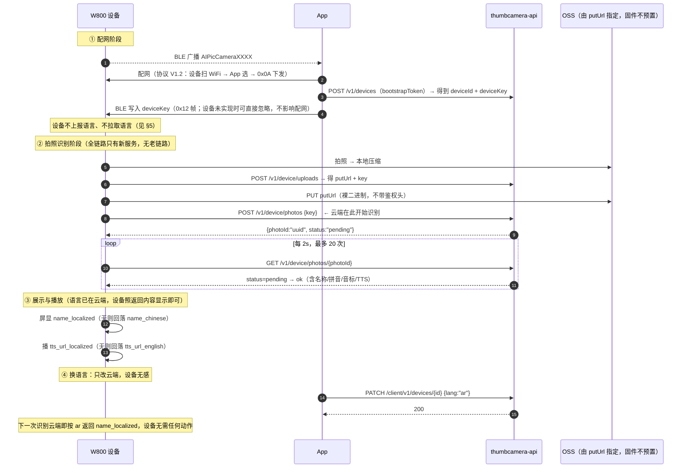

# 图灵 AI 拍学机 · 设备端对接说明 V3.1-HW

> **版本**：V3.1-HW · 2026-10-27 修订 2 · 面向 W800 固件 / 硬件 / 产线

---

## 🔴🔴 本阶段开发范围（2026-10-28 加注，开工前必读）

云端设备侧接口方案正在调整（工单 #2729 已回退为开发中），**上传与识别链路待重新定稿**。因此：

| 章节 | 内容 | 本阶段 |
|---|---|---|
| **§6.2** | 配网 P0 的 5 项（设备名 / 广播包 / `0x0E`·`0x88`·`0x89` 扫描 / 节流 / 空·失败码） | ✅ **只做这一节，可立即开工** |
| §1 / §2 / §3 / §4 / §5 | 域名、鉴权、时序图、上传与识别接口、显示回落 | 🔴 **暂缓，请勿开发**。等云端方案定稿后出修订 3 再开工 |
| §7 验收 / §8 缺口 | 含 P1 判据 | 按 §6.2 部分先验收 |

> 🔴 **`apikey` 必须照常上报**（`0x8D` / TLV `0x0A`），配网阶段**不要去掉**。
> 现有 App 的绑定判据是「`apikey` 与 `deviceId` 同时非空」，缺任一项判「设备无效」→ 配网直接失败。
> 本文档其余章节里出现的「不传 `apikey`」「老链路已停用」等表述，属修订 2 的临时结论，**以本声明为准**。

---

**修订 2 相对修订 1 的 4 处变更（P1 阶段方案待重新定稿，暂不执行）**

| # | 变更 | 原稿做法 | 本稿做法 |
|---|---|---|---|
| 1 | **云端链路** | 设备连 `nglearn`(wss) 做识别 + 新栈存卡，两个域名 | 🔴 **老链路全删**，只留 `thumbcamera-api` 一个域名（§0、§1、§3 已重写） |
| 2 | 服务器地址 | 运行时可配（NVS 地址表 + 失败回滚） | **编译期写死**，不做可配（§2 已重写） |
| 3 | 语言 | 设备开机 `POST /v1/device/config` 上报并拉取 | **设备完全不参与**，该接口本版不要求实现（§5 已重写） |
| 4 | 语言范围 | 9 种，设备要按 `name_localized_lang` 换字体 | **4 种**（zh / en / zh-Hant / ar），该字段保留但**不要求设备据此切换** |

> **配套文档**：《AI拍学机接口接入说明文档 V3.1》（识别接口，以此为准）、《WM_W800_BleWiFi 蓝牙配网协议 V1.2》（配网帧层）、《云端接口协议 V2.1 正式版》（新云端设备侧接口）。
> 本文档只写**设备端要落地什么**：连哪个地址、怎么鉴权、照片怎么传、配网怎么配。

---

## 0. 本文档是设备端唯一依据

### 0.1 文档关系

| 文档 | 状态 |
|---|---|
| **本文档（V3.1-HW）** | ✅ **设备端唯一依据**：连哪个地址、怎么鉴权、照片怎么传、配网怎么配 |
| 《云端接口协议 V2.1 正式版》 | ✅ 接口字段原文（设备侧接口以它为准） |
| 《WM_W800_BleWiFi 配网协议 V1.2》 | ✅ 配网帧层 |
| 《图灵AI拍学机接口接入说明文档 V3.1》（wss 老接口） | 🔴 **已停用，不再作为对接依据**，仅保留 `name_localized` 等字段语义参考 |

> 🔴 **老识别链路 `wss /api/study` 整体下线**：不建 WebSocket、不传 `apikey`。
> 识别改由新服务在 `POST /v1/device/photos` 之后自行完成，设备只轮询结果。
> **那份 V3.1 老接口文档不要再照着开发**——它会让人以为设备还要连 wss。

### 0.2 设备端实际要做的 5 个动作

| # | 动作 | 何时 | 鉴权 |
|---|---|---|---|
| 1 | `POST /v1/device/uploads` 申请直传 | 每张照片 | `Device-Key` |
| 2 | `PUT <putUrl>` 上传图片 | 紧接 #1 | **无** |
| 3 | `POST /v1/device/photos` 提交识别 | 上传成功后 | `Device-Key` |
| 4 | `GET /v1/device/photos/{photoId}` 轮询 | 每 2s，最多 20 次 | `Device-Key` |
| 5 | 屏显 + 播报 | 轮询 `ok` 后 | — |

> `POST /v1/devices` **不是设备调的**，是 App / 产线工具在配网时调一次。

### 0.3 本次变化总览（相对老链路）

| 项 | 以前 | 现在 |
|---|---|---|
| 域名 | `nglearn`(wss) + 新栈，两个 | **只有 `thumbcamera-api`**，一个 |
| 识别 | 设备直连 `wss /api/study` | 云端在 `photos` 后自己识别，设备只轮询 |
| 凭证 | `apikey`（整批公用）+ `dev_key` | 新链路只用 `dev_key`；`apikey` 待 App 放开判据后删（见 §1） |
| 图片 | 设备传老 OSS | 云端下发 `putUrl`，设备只认这个 |
| 语言 | 设备上报 / 拉取 | 设备完全不管 |

### 0.4 🔴 先定一件事：新机只配新版 App

新老硬件分属两套云（老硬件继续在老服务，新硬件只打新服务）。**照片是设备自己上传的**，设备写哪个库，App 就必须读哪个库。跨库不是语言降级，是数据彻底不通。

| 组合 | 设备传到 | App 从哪读 | 结果 |
|---|---|---|---|
| 老硬件 + 老 App | 老栈 | 老栈 | 正常，中英文 |
| 新硬件 + 新 App（v2.11.4 及以上） | 新栈 | 新栈 | 正常，四语 |
| 新硬件 + 老 App | 新栈 | 老栈 | **看不到任何照片** |
| 老硬件 + 新 App | 老栈 | 新栈 | 看不到历史照片（已决策接受） |

> 🔴 **因此：新硬件只配 v2.11.4 及以上 App。** 这不是可选项，是数据模型决定的硬约束。
> 售后口径统一为一句：**新机必须用新版 App**。

---

## 1. 只有一个域名（老链路全部下线）

🔴 **`nglearn` 与 `wss /api/study` 全部停用**：识别、卡片存储、图片直传都在新服务内完成。
固件里只保留一个新域名，编译期写死。

| 用途 | 地址 | 协议 | 鉴权 | 谁调 |
|---|---|---|---|---|
| 建设备（配网时一次） | `https://thumbcamera-api.turingapi.com` | HTTPS | `bootstrapToken` | App / 产线工具 |
| 申请直传 / 提交识别 / 轮询结果 | 同上 | HTTPS | `Device-Key` + `Device-Id` | 设备 |
| 图片直传 | 云端下发的 `putUrl`（OSS 预签名） | HTTPS PUT | **不带鉴权头** | 设备 |

> 🟡 **`apikey` 新链路已不用，但本版仍请照常上报**：现有 App 的绑定判据还要求
> 「`apikey` 与 `deviceId` 同时非空」，固件若不上报会被判成「设备无效」导致配网失败。
> 等 App 下一版放开该判据后，`0x0A` TLV 可去掉（顺带省 32 字节、少 2 个分片）。
>
> 设备侧**新链路真正需要的**凭证只有两个：
> - `dev_key`：一机一密，配网时由 App 建设备后写进设备，落 NVS
> - `bootstrapToken`：只在产线/配网工具建设备那一次用，**不能烧进设备**
>
> 除 `apikey` 这一项待 App 放开外，设备端**没有 WebSocket、没有第二个域名、没有第二个 OSS**。

### 1.1 图片到底传到哪

设备**不关心 OSS 桶是谁的**：`POST /v1/device/uploads` 返回的 `putUrl` 就是唯一入口，PUT 完即可。

> 🔴 **不要把任何 OSS 域名或 bucket 名预置到固件里**。换桶、换区域、换签名策略都由云端决定，
> 设备只认 `putUrl`。这是唯一保证「一套固件走天下」的做法。

---

## 2. 地址编译期写死（🔴 不做运行时可配）

### 2.1 结论

| 项 | 做法 |
|---|---|
| 唯一地址 | 固件内常量 `https://thumbcamera-api.turingapi.com` |
| 老识别地址 | 🔴 **不写入固件**（`nglearn` / `wss /api/study` 已停用） |
| 运行时可配 | 🔴 **不做**。不设 NVS 地址键、不做地址回滚、不做多环境切换 |
| 换环境 | 换环境＝重烧固件。量产固件只打生产地址；测试样机单独烧测试版固件 |

> **为什么不做可配**：可配会带来「地址×环境×版本」的组合爆炸，后续固件版本不可控。
> 收敛成「一套量产固件只打一个地址」，产线与售后都不用判断环境，
> 代价是测试样机需要单独烧一版——测试样机数量很少，可以接受。

### 2.2 唯一需要写入 NVS 的是 `dev_key`

| 键名 | 默认值 | 说明 |
|---|---|---|
| `dev_key` | 空 | 一机一密，配网时由 App 经 BLE 写入；为空则卡片服务不可用 |
| `boot_token` | 空 | 仅产线用，**出厂后可清空** |

> `dev_key` 必须落 NVS 且掉电不丢：它是设备调 `/v1/device/*` 的唯一凭证，
> 丢了就只能重新配网让 App 再写一次。

### 2.3 开机日志

开机打印当前生效的域名（脱敏到域名级别即可）+ `dev_key` 是否已写入（只打「有/无」，不打内容）。
现场定位「设备连错环境」「key 没写进去」全靠这两行。

---

## 3. 设备端全链路时序



> 🔴 **本图没有 `wss /api/study`**。老识别链路已整体下线，设备不建 WebSocket、不带 `apikey`。
> 识别由新服务在 `POST /v1/device/photos` 后自行完成，设备只需轮询拿结果。

---

## 4. 设备侧接口清单（新云端 5 个）

> 完整字段见《云端接口协议 V2.1 正式版》§2。这里只列设备必须实现的。

| # | 接口 | 何时调 | 鉴权 | 关键点 |
|---|---|---|---|---|
| 1 | `POST /v1/devices` | **配网时一次**（App 或产线） | `bootstrapToken` | `deviceId` 用云端下发的，**不要用 BLE 广播 MAC**（末位 +1 会错） |
| 2 | `POST /v1/device/uploads` | 每张照片 | `Device-Key` + `Device-Id` | 返回 `putUrl` + `key`，`putUrl` 有效期短，拿到就立刻 PUT |
| 3 | `PUT <putUrl>` | 紧随 #2 | **无** | 裸二进制；**不要带 Authorization**，带了 OSS 会拒 |
| 4 | `POST /v1/device/photos` | 上传成功后 | `Device-Key` | 返回 `photoId`，后面靠它轮询 |
| 5 | `GET /v1/device/photos/{photoId}` | 每 2s，最多 20 次 | `Device-Key` | `pending` 继续 / `ok` 显示 / `failed` 不播报 |

> 🔵 **本版不需要 `POST /v1/device/config`**。语言由 App 写到云端（`PATCH /client/v1/devices/{id}`），
> 设备既不读取也不上报，识别结果里云端已经按该语言翻好（见 §5）。

### 4.1 三个最容易踩的坑

| 坑 | 表现 | 正确做法 |
|---|---|---|
| `deviceId` 用 BLE 广播 MAC | 云端查不到该设备，接口全部失败 | 必须用 `POST /v1/devices` 返回值（广播 MAC 末位 +1，用错必错） |
| `PUT` 时带了 `Authorization` | OSS 返回 400/403 | 裸 PUT |
| 轮询间隔太短 | 触发 429 限流 | 2s 一次，指数退避 |

---

## 5. 语言：设备完全不参与（不上报、不拉取、不切换）

### 5.1 分工

| 角色 | 做什么 |
|---|---|
| App | 用户在 App 里选语言 → `PATCH /client/v1/devices/{id}` 写云端 |
| 云端 | 持有该设备的权威 `lang`；识别时按它翻译，并直接返回译好的字段 |
| **设备** | 🔴 **什么都不用做**：不传语言、不拉语言、不做语言切换 UI |

> 云端按 `deviceId` 匹配语言，**设备不需要知道自己是哪种语言**。
> 所以固件里不需要语言相关的任何逻辑，也不需要为此加 NVS 键。

### 5.2 语言取值范围（本版 4 项）

| 码 | 语言 | 方向 |
|---|---|---|
| `zh` | 简体中文 | LTR |
| `en` | 英语 | LTR |
| `zh-Hant` | 繁体中文 | LTR |
| `ar` | 阿拉伯语 | **RTL** |

> 本版只做这 4 种，先不做复杂语言集。产品原则上**每种语言对应一套完整界面 UI**，
> 而不是同一套 UI 只换字面——这是 App 侧的做法，设备侧若要做自己的 UI，按同样原则处理。
>
> 繁体是独立语言，不是简体的字体变体（`里`/`裡`、`发`/`發`），字面不同；
> 阿拉伯语是从右到左，排版方向要单独处理。

### 5.3 设备唯一要做的事：照返回内容显示，空了就回落

```
name_localized 非空        → 显示它
name_localized 为空        → 显示 name_chinese
tts_url_localized 非空     → 播它
tts_url_localized 为空     → 播 tts_url_english
```

> 🔵 `name_localized_lang`（云端**实际**返回的语言）字段**保留在响应里**，
> 但**本版不要求设备据此切换语言或字体**——设备当前没有语言相关的 UI 展示。
> 是否按该字段做字体切换，**由硬件方自行决定**，做与不做都不影响联调验收。

### 5.4 换语言什么时候生效

App 改完 → 云端立即是新值 → **下一次拍照识别**返回的就是新语言。
设备不需要重启、不需要重连、不需要拉取，也没有任何感知。

---

## 6. 实施顺序与配网改动（明天开工先做 §6.2）

### 6.1 建议的三步顺序

| 阶段 | 内容 | 前置依赖 | 建议 |
|---|---|---|---|
| **P0 配网** | §6.2 的 5 项（设备名、广播包、`0x0E`/`0x88`/`0x89` 扫描、节流、空/失败码） | 无，可独立开工 | **先做**。此阶段用现有 App 即可联调，不依赖新云端 |
| **P1 上传+识别** | §4 的 1~5 号接口（建设备、申请直传、PUT、提交、轮询） | 需要真实 `deviceId` + `dev_key` | 配网通了再做 |
| **P2 显示** | §5.3 的回落规则（有 `name_localized` 就用，空了回落中文） | 云端能返回该字段 | 最后做，不阻塞前面两项 |

> 🔴 **P0 与 P1 的衔接点**：`dev_key` 由 App 在配网时经 BLE 写入。
> 若 P1 阶段 App 侧还没接新栈，可先用产线工具/串口手工写入一台设备，单独做接口联调，
> **不要让 P1 等 App**。

### 6.2 配网具体改什么

完整帧格式见《WM_W800_BleWiFi 蓝牙配网协议 V1.2》。这里只给结论：

| 改什么 | 改成什么 | 工作量 |
|---|---|---|
| 设备名 | `AIPicCamera` + MAC 低 2 字节（4 位大写 hex），如 `AIPicCamera3F2A` | 0.5h |
| 广播包 | `Others` 前 4 字节填编号；`Version` 改 `0x12` | 0.5h |
| WiFi 扫描 | `0x0E` → 扫 2.4G（≤10 条，RSSI 降序，同 SSID 合并）→ `0x88` 逐条上报 + `0x89` 结束 | 1.5d |
| 扫描节流 | 串行化，扫期中收新请求回 `0x08`，间隔 ≥3s | 0.5d |
| 空/失败 | 无结果回 `0x09`，驱动失败回 `0x04` | 0.5h |

密钥协商、`0x0A`/`0x8A`、`0x0D`/`0x8D`、`0x11`/`0x91` **全部不动**。

### 6.3 绑定要不要改？

| 项 | 现状 | 本次 |
|---|---|---|
| 我方绑定判据 | `0x8D` 读到 `apikey` + `deviceId`、格式合法、`0x8A` 返回 0 | **保持不变**，`0x8D` 的 5 个 TLV 全部照常上报 |
| 图灵公众号 / 账号绑定 | 未接入（拍学机无账号域） | **本次不做** |

> **结论**：本次不引入图灵官方「公众号绑定 / IoT 账号绑定」。
> 那套绑定（`bapiKey@deviceId`、公众号 openId）属于另一条产品线（见 #2133 TuringIotDemo、#2441 开放平台），
> 与拍学机「设备本地绑定 + 云端按 deviceId 隔离」的模式不兼容，强行接入会引入账号体系与隐私合规问题。
> 如果后面产品要求「家长账号看到孩子设备」，那是**账号域的新需求**，需要单独立项，不塞进 v3.0.0。

---

## 7. 验收清单（硬件照这个自测）

| # | 项 | 通过判据 |
|---|---|---|
| 1 | 地址硬编码 | 开机日志打印唯一域名 `thumbcamera-api`，与编译值一致（**改不了才是对的**） |
| 2 | 设备名 | 手机蓝牙列表显示 `AIPicCameraXXXX`，与贴纸编号一致 |
| 3 | 配网 | 选 2.4G 热点 + 密码 → 15s 内拿到 IP |
| 4 | 5G 不出现在列表 | 列表里只有 2.4G 热点 |
| 5 | 扫描节流 | 连点刷新 5 次，日志只有 1 次真实扫描 |
| 6 | 建设备 | `POST /v1/devices` 返回 `deviceId` + `deviceKey` |
| 7 | `dev_key` 落地 | App 配网写入后**掉电重启**，日志显示 key 有值 |
| 8 | 传图 | `uploads → PUT → photos` 三步走通，`photoId` 非空 |
| 9 | 轮询 | 40s 内拿到 `status=ok` |
| 10 | 多语言显示 | 云端切 `ar` 后重拍一张，屏显 `name_localized` 为阿语文本（设备若不做阿语字库，此项由硬件方自行判定，**不列为必过**） |
| 11 | 回落 | 人为让 `name_localized` 为空，应回落显示 `name_chinese` |

---

## 8. 已知缺口（明确写出来，避免硬件背锅）

| # | 缺口 | 影响 | 归属 |
|---|---|---|---|
| 1 | 新云端 3 个 P0 未修（令牌可跨设备读库、`cloudDays` 可篡改、今日卡不去重） | **不影响硬件联调**，影响上线前的安全评审 | 云端（张文） |
| 2 | 🔴 **`tts_url_english` / `tts_url_localized` 当前返回空数组** | 设备**拿不到音频，只能看不能说**（TTS 通道待定稿） | 云端（#2729 A9） |
| 3 | 本版语言范围只有 `zh` / `en` / `zh-Hant` / `ar` | 日/韩/西/法/德不在本版范围，云端会回落中文 | 产品范围，非缺陷 |
| 4 | 无设备删除接口 | 测试设备清不掉，需人工清库 | 云端 |

> 🔴 **第 2 条是老链路删除后的最大代价，必须提前知道**：
> 以前 `wss /api/study` 会直接返回 `tts_url`，设备能出声；新服务的这两个字段目前是空数组。
> 所以在 TTS 通道通之前，**设备侧表现是「有字无声」**，联调时请按这个预期验收，不要当成 bug。
>
> 设备端要做的准备：轮询返回 `tts_url_*` 为空时**静默跳过播放**，不要报错、不要卡住显示。
> 等云端填上地址后，设备无需改代码即可出声。

---

*—— 文档结束 ——*
