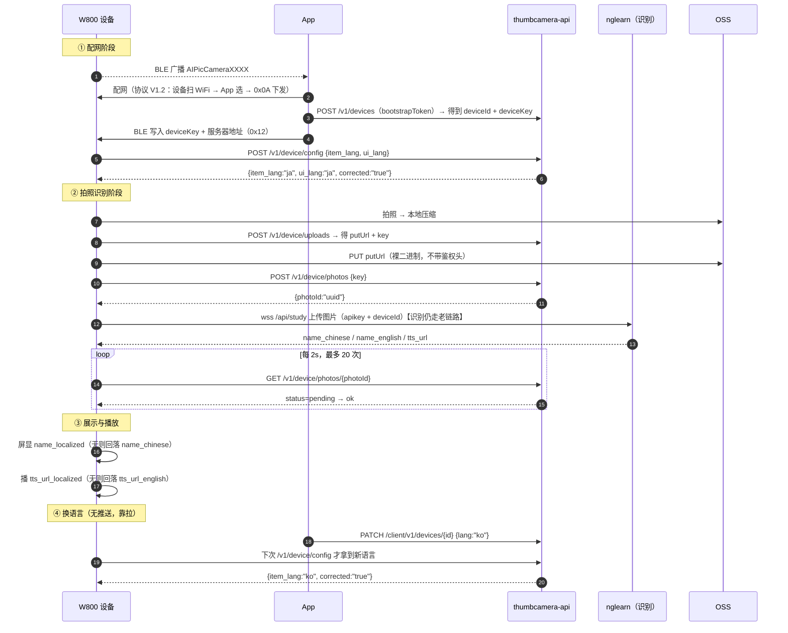

# 图灵 AI 拍学机 · 设备端对接说明 V3.1-HW

> **面向对象**：W800 固件 / 硬件 / 产线
> **本文档与识别接口文档的关系**：识别接口本身以《AI拍学机接口接入说明文档 V3.1》为准（研发已发布，见 §0.2）；
> 本文档只写**设备端要落地什么**：连哪个地址、怎么鉴权、什么时候上报语言、配网怎么配。
> **配套**：《WM_W800_BleWiFi 蓝牙配网协议 V1.2》（配网帧层）、《云端接口协议 V2.1 正式版》（新云端设备侧接口）。

---

## 0. 先把三份文档的关系说清

### 0.1 结论

| 你手上的东西 | 是什么 | 状态 |
|---|---|---|
| 《图灵AI拍学机接口接入说明文档_V3.0_2025.10.23》（PDF） | 研发出的**基线版**，识别接口原文 | ✅ 有效，但缺多语言字段 |
| 《图灵AI拍学机接口接入说明文档_V3.1_更新需求》（我们提的 md） | 我方**提给研发的需求清单**，不是正式文档 | ⚠️ 只是需求，不能作为对接依据 |
| 《AI拍学机接口接入说明文档 V3.1》（`turing-ai-study-api-V3.1.md`） | **研发已发布的 V3.1 正式版** | ✅ **设备对接以这份为准** |

### 0.2 关系图

```
V3.0（研发基线，2025.10.23）
   │
   │  我方提需求：只改 2 处（2.2.2 加一段说明、2.3 加 3 个字段）
   ▼
《V3.1 更新需求》（我们写的，不是研发产物）
   │
   │  研发据此修订、评审通过
   ▼
《AI拍学机接口接入说明文档 V3.1》（正式版）  ← 设备按这份做
   │  改动只有：返回新增 name_localized / name_localized_lang / tts_url_localized
   │  请求侧一个字都没改
```

> 🔴 **所以回答你的问题**：是的，《图灵AI拍学机接口接入说明文档_V3.1_更新需求》指的就是 V3.1 这件事，
> 但**它是我们提的需求稿，不是研发定稿**。研发已按它出了正式版，正式版我已经从工单 #2729 下载到
> `docs/dl/turing-ai-study-api-V3.1.md`（21 KB）。**给硬件看正式版，不要给需求稿。**

### 0.3 V3.1 到底改了什么（一句话）

> **请求侧不变，只在「拍学万物」的返回里加了 3 个字段。** 固件如果只想先跑通，
> 甚至可以先不看这 3 个字段，行为与 V3.0 完全一致。

| 位置 | 改动 | 设备要做什么 |
|---|---|---|
| 2.2.2 初始化参数 | 只加一段说明：语言由 App 设置、云端按 `deviceId` 匹配，**设备不传** | 无 |
| 2.3 返回 data | 🔴 新增 `name_localized` / `name_localized_lang` / `tts_url_localized` | 有则优先用，无则回落 `name_chinese`/`name_english` |
| 2.3 `name_chinese` | 说明补一句「保留以兼容存量设备」 | 无 |
| 1 / 2.1 / 2.2.1 / 2.2.3 / 2.2.4 / 3 / 4 | **一个字都没改** | 无 |

---

## 1. 设备端要连两个域名（这是本次最大的变化）

以前设备只连一个 `nglearn`；现在**识别**和**卡片存储**是两套服务，各连各的。

| 用途 | 地址 | 协议 | 鉴权 | 谁在用 |
|---|---|---|---|---|
| **识别**（拍学万物） | `wss://nglearn.turingapi.com/api/study` | WebSocket | `apikey` + `deviceId` | 老服务，不变 |
| **卡片存储 / 语言配置** | `https://thumbcamera-api.turingapi.com` | HTTPS | `Device-Key` + `Device-Id` | 🔴 新服务 |
| 图片直传 | OSS `putUrl`（云端临时下发） | HTTPS PUT | **不带鉴权头** | 新服务下发 |

> ⚠️ 两个域名的凭证**完全不同**，不要混：
> - `apikey`（32 位 hex）：识别用，整批公用，出厂烧录
> - `Device-Key`：卡片用，**一机一密**，配网时由 App 建设备后写进设备
> - `bootstrapToken`（`tcb_…`）：只在**产线/配网工具**建设备那一次用，不能烧进设备

---

## 2. 服务器地址必须可配置（不做这个，以后每次换环境都要重烧）

### 2.1 NVS 键表

| 键名 | 默认值 | 说明 |
|---|---|---|
| `srv_study` | `wss://nglearn.turingapi.com/api/study` | 识别服务 |
| `srv_card` | `https://thumbcamera-api.turingapi.com` | 卡片服务 |
| `dev_key` | 空 | 一机一密，配网时写入 |
| `boot_token` | 空 | 仅产线用，**出厂后可清空** |
| `item_lang` | `zh` | 物品语言 |
| `ui_lang` | `zh` | 界面语言 |

### 2.2 规则

| 规则 | 要求 |
|---|---|
| 优先级 | NVS 有值 → 用 NVS；NVS 空 → 用编译期默认值 |
| 写入途径 | ① 产线工具串口写 ② 配网时 App 经 BLE `0x12` 下发（见配网协议 V1.2） |
| 切换风险 | 🔴 换 `srv_card` 后，`Device-Key` 与旧环境不匹配会 401；**换地址必须同时换 key** |
| 回滚 | 保留上一组地址（`srv_card_prev`），连续 3 次连接失败自动回滚并上报 |
| 打印 | 开机日志打印当前生效地址（脱敏到域名级别），便于现场定位 |

> 🔴 **为什么必须做**：现在地址是编在固件里的，测试/预发/生产三个环境要烧三版固件；
> 出厂设备想迁到新环境只能返厂。加上可配置后，一次烧录通吃，环境切换由 App 或产线工具完成。

---

## 3. 设备端全链路时序



---

## 4. 设备侧接口清单（新云端 5 个）

> 完整字段见《云端接口协议 V2.1 正式版》§2。这里只列设备必须实现的。

| # | 接口 | 何时调 | 鉴权 | 关键点 |
|---|---|---|---|---|
| 1 | `POST /v1/devices` | **配网时一次**（App 或产线） | `bootstrapToken` | `deviceId` 用云端下发的，**不要用 BLE 广播 MAC**（末位 +1 会错） |
| 2 | `POST /v1/device/uploads` | 每张照片 | `Device-Key` + `Device-Id` | 返回 `putUrl` + `key`，`putUrl` 有效期短，拿到就立刻 PUT |
| 3 | `PUT <putUrl>` | 紧随 #2 | **无** | 裸二进制；**不要带 Authorization**，带了 OSS 会拒 |
| 4 | `POST /v1/device/photos` | 上传成功后 | `Device-Key` | 返回 `photoId`，后面靠它轮询 |
| 5 | `GET /v1/device/photos/{photoId}` | 每 2s，最多 20 次 | `Device-Key` | `pending` 继续 / `ok` 显示 / `failed` 不播报 |
| 6 | `POST /v1/device/config` | **开机 + 每次连上 Wi-Fi** | `Device-Key` | 字段必须 **下划线**，返回值里的 `item_lang` 是权威值 |

### 4.1 三个最容易踩的坑

| 坑 | 表现 | 正确做法 |
|---|---|---|
| `item_lang` 写成 `itemLang` | **不报错**，但云端视为没上报，`reported_*` 返回空串 | 强制下划线 |
| `PUT` 时带了 `Authorization` | OSS 返回 400/403 | 裸 PUT |
| 轮询间隔太短 | 触发 429 限流 | 2s 一次，指数退避 |

---

## 5. 语言：设备只「上报」和「拉取」，不「决策」

| 角色 | 做什么 |
|---|---|
| App | 用户在 App 里选语言 → `PATCH /client/v1/devices/{id}` 写云端 |
| 云端 | 持有该设备的权威 `lang`；识别时按它翻译 |
| **设备** | ① 开机/联网后 `POST /v1/device/config` 上报**自己当前**的 `item_lang`/`ui_lang`<br>② 看返回的 `corrected`，是 `"true"` 就用返回的值切换<br>③ 识别结果直接读 `name_localized`，**不要自己传语言** |

> 🔴 **没有推送通道**：App 改语言后，设备**不会立刻变**，要等下一次 `config` 拉取（开机或重连）。
> 这是当前架构的既定行为，不是 bug。若产品要求「改完立刻变」，需要云端加 MQTT/WebSocket 推送，属新需求。

### 5.1 语言码（9 项，设备要能认）

| 码 | 语言 | 码 | 语言 | 码 | 语言 |
|---|---|---|---|---|---|
| `zh` | 简体中文 | `ja` | 日语 | `fr` | 法语 |
| `zh-Hant` | **繁体中文** | `ko` | 韩语 | `de` | 德语 |
| `en` | 英语 | `es` | 西班牙语 | `ru` | 俄语 |

> ⚠️ **繁体是独立语言**，不是简体的字体变体：文字不同（`里`/`裡`、`发`/`發`），
> 字库必须单独放，不能靠中文码表渲染。

### 5.2 回落规则（设备必须实现）

```
name_localized 非空 且 name_localized_lang 存在  → 用它
否则 name_localized 为空                          → 用 name_chinese（若 ui_lang 是英文则 name_english）
tts_url_localized 非空 → 播它，否则播 tts_url_english
```

> 🔴 **`name_localized_lang` 是「云端实际返回的语言」，不是「请求的语言」**。
> 云端发生回落时（比如某词没翻出来），它会回 `zh`，设备要据此**换一套字体**，
> 否则会出现「韩语界面里冒出中文方块」。

---

## 6. 配网：本次唯一需要改固件的地方

完整帧格式见《WM_W800_BleWiFi 蓝牙配网协议 V1.2》。这里只给结论：

| 改什么 | 改成什么 | 工作量 |
|---|---|---|
| 设备名 | `AIPicCamera` + MAC 低 2 字节（4 位大写 hex），如 `AIPicCamera3F2A` | 0.5h |
| 广播包 | `Others` 前 4 字节填编号；`Version` 改 `0x12` | 0.5h |
| WiFi 扫描 | `0x0E` → 扫 2.4G（≤10 条，RSSI 降序，同 SSID 合并）→ `0x88` 逐条上报 + `0x89` 结束 | 1.5d |
| 扫描节流 | 串行化，扫期中收新请求回 `0x08`，间隔 ≥3s | 0.5d |
| 空/失败 | 无结果回 `0x09`，驱动失败回 `0x04` | 0.5h |

**合计 ≈ 3.5 人天**（不含联调）。密钥协商、`0x0A`/`0x8A`、`0x0D`/`0x8D`、`0x11`/`0x91` **全部不动**。

### 6.1 绑定要不要改？

| 项 | 现状 | 本次 |
|---|---|---|
| 我方绑定判据 | 读到 `apikey`+`deviceId`、格式合法、`0x8A` 返回 0 | **不变** |
| 图灵公众号 / 账号绑定 | 未接入（拍学机无账号域） | **本次不做** |

> **结论**：本次不引入图灵官方「公众号绑定 / IoT 账号绑定」。
> 那套绑定（`bapiKey@deviceId`、公众号 openId）属于另一条产品线（见 #2133 TuringIotDemo、#2441 开放平台），
> 与拍学机「设备本地绑定 + 云端按 deviceId 隔离」的模式不兼容，强行接入会引入账号体系与隐私合规问题。
> 如果后面产品要求「家长账号看到孩子设备」，那是**账号域的新需求**，需要单独立项，不塞进 v3.0.0。

---

## 7. 验收清单（硬件照这个自测）

| # | 项 | 通过判据 |
|---|---|---|
| 1 | 地址可配置 | 串口改 `srv_card` 后重启，日志显示新域名且能连上 |
| 2 | 设备名 | 手机蓝牙列表显示 `AIPicCameraXXXX`，与贴纸编号一致 |
| 3 | 配网 | 选 2.4G 热点 + 密码 → 15s 内拿到 IP |
| 4 | 5G 不出现在列表 | 列表里只有 2.4G 热点 |
| 5 | 扫描节流 | 连点刷新 5 次，日志只有 1 次真实扫描 |
| 6 | 建设备 | `POST /v1/devices` 返回 `deviceId` + `deviceKey` |
| 7 | 语言拉取 | `POST /v1/device/config` 返回 `corrected`，值类型是**字符串** `"true"` |
| 8 | 下划线字段 | 把 `item_lang` 临时改成 `itemLang`，`reported_item_lang` 应为空串（用于确认服务端行为） |
| 9 | 传图 | `uploads → PUT → photos` 三步走通，`photoId` 非空 |
| 10 | 轮询 | 40s 内拿到 `status=ok` |
| 11 | 多语言显示 | 云端切 `ko` 后重连设备，屏显韩语且**无方块** |
| 12 | 回落 | 人为让 `name_localized` 为空，应回落显示 `name_chinese` |

---

## 8. 已知缺口（明确写出来，避免硬件背锅）

| # | 缺口 | 影响 | 归属 |
|---|---|---|---|
| 1 | 新云端 4 个 P0 未修（令牌可跨设备读库、`cloudDays` 可篡改、`config` 协议未定稿、今日卡不去重） | **不影响硬件联调**，影响上线前的安全评审 | 云端（张文） |
| 2 | 5 语言 `tts_url_localized` 全空 | 日/韩/西/法/德**播报暂无声音**，只能看文字 | 云端 |
| 3 | 云端无推送通道 | 改语言要等设备下次启动才生效 | 架构层，需新需求 |
| 4 | 无设备删除接口 | 测试设备清不掉，需人工清库 | 云端 |

> 前两条意味着：**多语言「看得见」已经能做，「听得见」还要等 TTS**。
> 演示时如果要播报，建议只用中英双语，其他语言先展示文字。

---

*—— 文档结束 ——*
