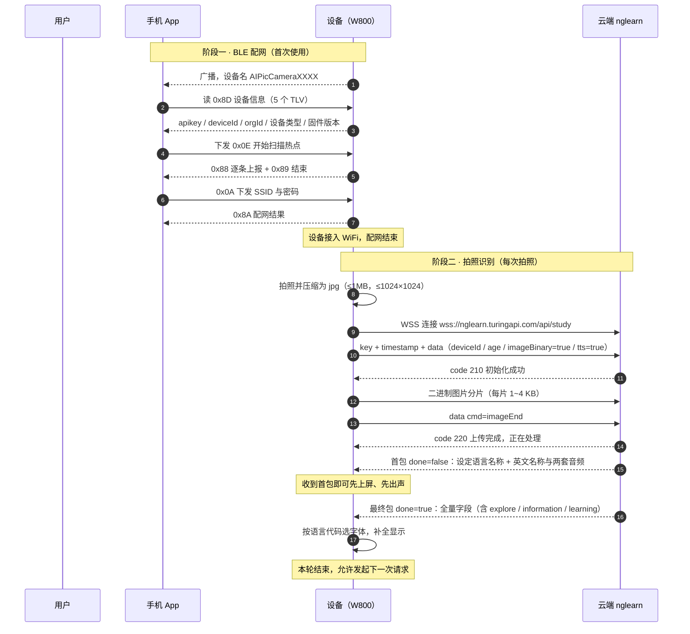

# 图灵 AI 拍学机 · 设备端对接说明 V3.1-HW

> **文档版本**：V3.1-HW（客户版）
> **发布日期**：2026-10-28
> **适用对象**：W800 固件开发 / 硬件设计 / 产线测试
> **配套文档**：《AI 拍学机接口接入说明文档 V3.1》、《WM_W800_BleWiFi 蓝牙配网协议 V1.2》

---

## 0. 一页结论（建议先看这一页）

### 0.1 一句话概括

设备端只用**一条云端链路**（`wss://nglearn.turingapi.com/api/study`）完成拍照识别，用 **BLE 配网**把设备接入 WiFi。本版云端在识别结果里**新增 3 个字段**，用于按用户设定的语言显示与朗读；请求结构、加密方式、上传流程、状态码全部不变。

### 0.2 设备端要实现的事

| # | 做什么 | 何时 | 是否本版新增 |
|---|---|---|---|
| 1 | BLE 配网（帧格式按《配网协议 V1.2》） | 首次使用 / 换网络 | 否，已有能力 |
| 2 | `0x8D` 上报设备信息 5 个 TLV | 配网握手 | 否，已有能力 |
| 3 | 拍照后经 wss 上传图片并接收识别结果 | 每次拍照 | 否，已有能力 |
| 4 | 解析并容错读取 3 个新增字段 | 每次拍照 | **是，本版新增** |
| 5 | 屏显名称 + 播放音频（含回落规则） | 拿到结果后 | **是，本版新增回落逻辑** |

### 0.3 设备端不需要做的事

| 项 | 说明 |
|---|---|
| 不传语言、不存语言、不上报语言 | 语言由手机 App 写入云端，云端按 `deviceId` 匹配，设备每次请求自然拿到当前语言结果 |
| 不做语言切换界面 | 设备无语言设置项，也不需要重启、重连或重新配网来生效 |
| 不多次查询结果、不申请上传凭证 | 结果在同一条 wss 连接内多包下发，`done=true` 即结束 |
| 不预置 OSS 域名或桶名 | 图片直接以二进制流上传，不经过任何对象存储地址 |

> **本版对固件的改动量很小**：现有链路已经可用，新增工作集中在「多认 3 个字段」与「显示和播放的回落逻辑」。

---

## 文档修订记录

| 文档版本号 | 修订日期 | 修订原因 |
|---|---|---|
| V1.0 | 2025.10.20 | 创建设备端对接说明，覆盖配网与拍照识别全链路 |
| V2.0 | 2026.09.18 | 补充图片二进制分片上传规范与结果分包说明 |
| **V3.1-HW（客户版）** | **2026.10.28** | **识别结果新增 3 个语言相关字段；明确首包内容、回落规则与设备端显示播放规范。请求侧、加密、上传流程、状态码均不变** |

---

## 1. 产品与文档说明

### 1.1 产品概述

AI 拍学机是一款面向儿童的智能学习产品。设备通过摄像头拍摄物品，将照片上传至图灵云端进行识别，云端返回物品的中英文名称、拼音、音标、描述、拓展知识与语音合成音频，设备在屏幕上显示并以扬声器朗读。

### 1.2 本文档的范围

本文档只说明**设备端要落地什么**：连哪个地址、怎么鉴权、照片怎么传、结果怎么读、屏幕怎么显示、音频怎么播。

接口字段的完整定义以《AI 拍学机接口接入说明文档 V3.1》第 2 章为准；配网帧格式以《WM_W800_BleWiFi 蓝牙配网协议 V1.2》为准。本文档与上述两份文档**无冲突**，如遇表述差异，字段与帧格式以原文档为准，设备侧处理策略以本文档为准。

### 1.3 设备端职责边界

| 角色 | 负责什么 |
|---|---|
| 手机 App | 提供语言选择界面，把用户选择写入云端并与 `deviceId` 绑定；发起配网 |
| 图灵云端 | 保存每个 `deviceId` 的设定语言；识别时按该语言产出名称与音频；如实回显实际返回的语言代码 |
| **设备（拍学机）** | **配网、拍照、上传、解析、显示、播放。不存语言、不传语言、不感知语言变更** |

### 1.4 术语

| 术语 | 含义 |
|---|---|
| 设定语言 | 用户在 App 上选择的「识别结果按哪种语言返回、用哪种语音合成」。由云端按 `deviceId` 保存 |
| 首包 | 识别过程中先下发的一包结果，用于让设备尽快上屏、尽快出声。`done=false` |
| 最终包 | 识别结束时下发的完整结果。`done=true` |
| 回落 | 云端未能提供设定语言的内容时，改为返回简体中文。这是正常响应，不是错误 |

---

## 2. 通信链路总览

### 2.1 两条链路

设备只涉及两条链路，鉴权方式**完全不同**：

| 链路 | 承载 | 加密方式 | 密钥来源 | 连接方式 |
|---|---|---|---|---|
| BLE 配网 | 手机 ↔ 设备 | AES / **ECB** / PKCS7 | 一次一密，由 `0x0F` RSA 协商得到 | BLE GATT |
| 云端识别 | 设备 ↔ `nglearn` | AES / **CBC** / PKCS5Padding | `md5(accesskey + secret + timestamp)` 取前 16 位小写 | WSS |

### 2.2 两套算法不能共用一份配置

BLE 配网用 **ECB**，云端请求用 **CBC**。二者分组模式不同、填充方式不同，**不能共用同一份加解密代码的默认配置**。这是历史上最容易出错的一处，请在代码里显式区分，不要依赖全局默认值。

> 云端请求的 CBC 偏移量（IV）等于密钥本身，见 4.2。

### 2.3 全链路时序



---

## 3. BLE 配网

配网帧格式、分片、超时、应答码全部按《WM_W800_BleWiFi 蓝牙配网协议 V1.2》实现。本章只列**必须做对的几件事**。

### 3.1 设备信息上报（`0x8D`）

App 的绑定判据是「`apikey` 与 `deviceId` **同时**非空，且格式合法」，缺任一项会判为设备无效，配网直接失败。设备必须在 `0x8D` 响应中完整上报 5 个 TLV：

| TLV | 含义 | 长度 | 格式 |
|---|---|---|---|
| `0x0A` | APIKEY | 32 字节 | ASCII，32 位小写十六进制，无结束符。出厂烧录，整批一致 |
| `0x0B` | DEVICE_ID | ≤ 18 字节 | ASCII，无结束符。当前为 12 位小写十六进制 |
| `0x0C` | ORG_ID | 2 字节 | 小端序，联盛德固定为 `0C 07`（即 `0x070C`） |
| `0x0D` | DEVICE_TYPE | 1 字节 | 拍学机填 `0x01` |
| `0x0E` | FIRMWARE_VER | 1 字节 | 高 4 位为主版本、低 4 位为次版本，如 `0x11` 表示 V1.1 |

5 个 TLV 合计使 PAYLOAD 增加约 58 字节。按协议单帧分片上限 14 字节计算，该响应会被拆成 5 至 6 片，因此 **`Flag[5]` 分片标志与 `NO` 序号必须严格正确**：非末片置 1、末片置 0，`NO` 从 0 连续递增，缺一片即解析失败。

### 3.2 兼容规则（必须实现）

设备固件会先于 App 的新版本存在，也会晚于 App 的新版本存在，因此必须能容忍自己不认识的命令与字段：

| 收到什么 | 处理方式 |
|---|---|
| 不认识的命令码 | **丢弃整帧，不回执**。不报错、不阻断配网流程 |
| 不认识的 TLV 类型 | **跳过该 TLV，继续解析同帧内后续 TLV**。禁止整帧解析失败 |

> 举例：App 可能下发 `0x12`（设备配置）。设备当前没有对应实现时按上表处理即可，App 侧不等待该帧回执，不回执对用户体验没有影响。

### 3.3 热点扫描（`0x0E` / `0x88` / `0x89`）

| 项 | 要求 |
|---|---|
| 触发 | 收到 `0x0E` 后开始扫描，只扫 **2.4G** 频段 |
| 上报 | 每条热点一帧 `0x88`，全部发完后发一帧 `0x89` 表示结束 |
| `0x88` 行格式 | `序号 │ RSSI │ AUTH │ SSID`。**SSID 取第 3 个竖线之后的整段内容**（SSID 本身可能含竖线，不能按第 2 个竖线截断） |
| 条数 | 单次最多上报 10 条，按 RSSI 从强到弱排序 |
| 同 SSID 多个 AP | **逐条上报，不合并、不去重**。合并会造成「设备实际扫到 10 个、App 只显示 8 个」 |
| 无结果 | 回 `0x09` |
| 驱动失败 | 回 `0x04` |

### 3.4 扫描节流

扫描必须串行化。扫描进行中再次收到 `0x0E`，直接回 `0x08`（忙），不要启动第二次扫描。两次扫描之间的最小间隔为 3 秒。

> 用户连续点击刷新是常见操作。没有节流会导致 WiFi 驱动被反复打断，表现为扫描结果为空或设备无响应。

### 3.5 不下发的命令

服务器地址为**编译期写死**（见 4.1），因此 `0x13`（SERVER_ENDPOINT）、`0x14`（SERVER_PROFILE）**不会下发**，请勿预留实现与测试用例。

---

## 4. 云端识别接口

### 4.1 域名地址

```
正式环境：wss://nglearn.turingapi.com/api/study
```

该地址在固件中**编译期写死**，不做运行时配置、不设 NVS 地址项、不做多环境切换。

| 项 | 做法 |
|---|---|
| 唯一地址 | 固件内常量 `wss://nglearn.turingapi.com/api/study` |
| 运行时可配 | 不做。不设地址键、不做地址回滚、不做环境切换 |
| 换环境 | 换环境等同重烧固件。量产固件只打生产地址，测试样机单独烧测试版固件 |

开机日志建议打印当前生效的域名（到域名级别即可），便于现场快速判断「设备是否连到预期环境」。

### 4.2 数据加密方式

```
加密模式  CBC
填充      PKCS5Padding
数据块    128 位（密钥为 16 位）
输出      base64 编码字符串
编码      utf-8
密钥      Accesskey + 密钥管理页 Secret + 入参 timestamp 拼成字符串
          → 对该字符串取 16 位小写 md5 值
偏移量 IV 等于密钥
```

请求外层示例如下（加密时 `data` 为密文字符串）：

```json
{
  "key": "ak_01jwdhtefw*****ash9js28cs",
  "timestamp": "1761000000000",
  "data": "加密后的内容"
}
```

未加密请求示例如下（联调期可用，正式环境建议开启加密）：

```json
{
  "key": "ak_01jwdhtefw*****ash9js28cs",
  "timestamp": 1761000000000,
  "data": {
    "deviceId": "a1b2c3d4e5f6",
    "age": 6,
    "imageFormat": "jpg",
    "imageBinary": true,
    "tts": true,
    "clientRequestId": "1a2b3c4d"
  }
}
```

**请求外层参数**

| 参数 | 类型 | 必须 | 说明 |
|---|---|---|---|
| key | String | Y | 平台应用的 Accesskey，32 位十六进制。出厂烧录，整批一致 |
| timestamp | Long | Y | 毫秒时间戳。参与密钥派生，必须与实际发送时间一致 |
| data | Object 或 String | Y | 业务数据。启用加密时整体为密文字符串 |

`secret` 烧录在固件内，**不得出现在 App、日志或对外文档中**。

### 4.3 初始化参数（data 字段）

| 字段 | 必须 | 类型 | 说明 |
|---|---|---|---|
| deviceId | Y | String | 设备唯一标识，字母与数字组成，长度不超过 18。**必须与 `0x8D` 上报的 `DEVICE_ID` 完全一致** |
| age | Y | int | 3~12。3~6 为学前、7~9 为小学低段、10~12 为小学高段，决定返回内容的深度 |
| imageFormat | Y | String | 仅支持 `jpg` / `jpeg` / `png` |
| imageBinary | N | boolean | 使用二进制流上传图片时置 `true`，并配合 4.4、4.5 两步 |
| imageUrl | N | String | 图片 URL 方式入参。与另两种方式三选一 |
| imageBase64 | N | String | 图片 base64 方式入参。与另两种方式三选一 |
| functions | N | array | 取值 `explore`、`learning`。不传则不返回对应字段 |
| tts | N | boolean | 是否输出语音合成结果，默认 `false`。**需要音频必须显式传 `true`** |
| ttsPrefix | N | boolean | 是否在中文语音前增加「这是」前缀，仅对中文音频有效 |
| clientRequestId | N | String | 不超过 32 字符的请求唯一标识，输出时原样回传，用于对账 |

图片入参方式支持 URL、base64、二进制流三种，三选一。设备端推荐二进制流（见 4.4），可避免把整图读入内存。

**图片规格**

| 项 | 要求 |
|---|---|
| 格式 | png / jpg / jpeg |
| 大小 | 不超过 1 MB |
| 分辨率 | 不超过 1024 × 1024 |
| 推荐 | 约 200 KB，识别效果与响应耗时的平衡点最佳 |

> 设备不传任何语言参数。语言由 App 写入云端、云端按 `deviceId` 匹配，详见第 5 章。

### 4.4 上传图片数据

初始化成功（收到 `code=210`）后，连续发送图片的二进制分片。

| 项 | 要求 |
|---|---|
| 分片大小 | **单片 1~4 KB**，上限 64 KB，由固件按可用 RAM 决定。服务端不限制分片数量 |
| 发送顺序 | 严格按图片字节流顺序发送，不得跳片、不得乱序 |
| 失败重传 | 单片失败只重传该片，不整包重来 |
| 峰值内存 | 分片缓冲按 1~4 KB 规划，W800 可用 RAM 不支持整图驻留 |

> 若当前固件的分片大小不在 1~4 KB 区间，请调整并回报实际取值，以便服务端侧核对超时参数。

### 4.5 上报图片结束标识

分片全部发送完成后，发送结束标识：

```json
{
  "key": "ak_01jwdhtefw*****ash9js28cs",
  "timestamp": 1761000000000,
  "data": {
    "cmd": "imageEnd"
  }
}
```

该帧需携带 `key` 与 `timestamp`，与普通请求一致。未发送 `imageEnd` 时云端不会开始识别，表现为一直等到超时。

### 4.6 返回数据结构

#### 4.6.1 首包（`done=false`）

```json
{
  "clientRequestId": "1a2b3c4d",
  "code": 200,
  "data": {
    "name_localized": "Bus",
    "name_localized_lang": "en",
    "name_english": "Bus",
    "tts_url_localized": [
      "http://turing-iot-tts-oss.turingapi.com/tts/third/tts-1111.mp3"
    ],
    "tts_url_english": [
      "http://turing-iot-tts-oss.turingapi.com/tts/third/tts-2222.mp3"
    ]
  },
  "done": false,
  "globalId": "960b68312a694c4e953e5c6753ee8506_dd7ff4d88354a25e",
  "message": "success"
}
```

首包的目的是让设备**尽早上屏、尽早出声**，因此内容为「设定语言名称 + 英文名称」与对应两套音频。首包**不承诺包含** `name_chinese`、`explore`、`information`、`learning`。

> 设定语言为简体中文时，首包的 `name_localized` 即为中文，`name_localized_lang` **不出现**（按 5.2 处理，不是错误）。
> 设定语言为英语时，`tts_url_localized` 与 `tts_url_english` 内容相同，这是正常的，二者指向同一语言的音频。设备按 6.3 的优先级取用即可，不需要去重判断。

#### 4.6.2 最终包（`done=true`）

```json
{
  "clientRequestId": "1a2b3c4d",
  "code": 200,
  "data": {
    "name_chinese": "公交车",
    "name_localized": "バス",
    "name_localized_lang": "ja",
    "name_english": "Bus",
    "tts_url": [
      "http://turing-iot-tts-oss.turingapi.com/tts/third/tts-433d85a0.mp3"
    ],
    "tts_url_english": [
      "http://turing-iot-tts-oss.turingapi.com/tts/third/tts-fcf5f64d.mp3"
    ],
    "tts_url_localized": [
      "http://turing-iot-tts-oss.turingapi.com/tts/third/tts-8b1c9e2f.mp3"
    ],
    "information": {
      "pinyin": "",
      "phonetic": "/bʌs/",
      "name_english": "Bus",
      "description": "公交车是一种公共交通工具……"
    },
    "explore": [
      { "item": "公交站", "relationship": "公交车会在公交站停靠" }
    ],
    "learning": [
      { "question": "公交车为什么有不同颜色？", "answer": "不同颜色用于区分线路与用途" }
    ]
  },
  "done": true,
  "globalId": "960b68312a694c4e953e5c6753ee8506_633fee47a7614ef4",
  "message": "success"
}
```

`explore` 与 `learning` 仅在请求时传了 `functions` 才返回；`information` 随最终包返回。

> 音频地址当前为 `http://`。固件需确保支持该协议的下载与播放，不要强制校验 https。

#### 4.6.3 外层参数说明

| 字段 | 必须 | 类型 | 说明 |
|---|---|---|---|
| code | Y | int | 状态码，见第 6 章 |
| data | Y | json | 接口数据 |
| done | Y | boolean | 是否已结束。`false` 为中间结果，`true` 为最终结果 |
| globalId | Y | String | 请求唯一标识，用于对账与问题定位 |
| message | Y | String | 状态码对应的说明 |
| clientRequestId | N | String | 请求时传入则原样回传 |

#### 4.6.4 data 字段说明

| 字段 | 必须 | 类型 | 说明 |
|---|---|---|---|
| name_chinese | Y | String | 物品中文名称。兼容存量设备保留，简体设置下与 `name_localized` 取值相同 |
| name_localized | N | String | **设定语言的物品名称**。语言由 App 设置、云端按 `deviceId` 匹配，设备无需传参 |
| name_localized_lang | N | String | **`name_localized` 实际使用的语言代码**。⚠️ 回显的是「实际返回的语言」而非「期望的语言」；简体中文时该字段不返回 |
| name_english | Y | String | 物品英文名称。固定英文，不受设定语言影响 |
| tts_url | N | Array | 中文音频地址数组，可能为空数组 |
| tts_url_english | N | Array | 英文音频地址数组，可能为空数组 |
| tts_url_localized | N | Array | **设定语言的音频地址数组**，结构与 `tts_url` 一致。该语言音频尚未就绪时返回空数组 |
| information | N | json | 物品信息，含 `pinyin`、`phonetic`、`name_english`、`description` |
| explore | N | array | 关系探索数据，含 `item`、`relationship` |
| learning | N | array | 多维学习数据，含 `question`、`answer` |

3 个语言相关字段的必填性均为 N。含义是：**设备必须能在字段不存在时正常工作**，回落到 `name_chinese` 与 `tts_url`。这保证了两点：老固件不解析新字段也不会出错；新固件遇到不含新字段的响应也不会崩溃。

#### 4.6.5 information 子字段

| 字段 | 必须 | 类型 | 说明 |
|---|---|---|---|
| pinyin | Y | String | 中文拼音。非简体中文语言下内容为空串 |
| phonetic | N | String | 英文音标 |
| name_english | Y | String | 英文名称 |
| description | N | String | 物品简短描述。语言不保证与设定语言一致，设备需容忍其为中文或空 |

字段存在但内容可能为空串，设备端应隐藏空内容所在行，不要显示为空白占位。

### 4.7 连接约束

| 项 | 要求 |
|---|---|
| 并发 | 单连接**不允许并发请求**：上一轮未收到 `done=true` 之前，不得发送下一轮请求 |
| 连接复用 | 建议复用同一条 wss 连接完成多次拍照，避免每次重新握手 |
| 空闲处理 | 空闲超过 30 秒建议断开并在下次拍照时重建，不要长期挂死连接 |
| 消息保序 | 同一条连接内的消息按序处理，不得因为收到中间包而提前关闭连接 |

---

## 5. 语言：设备完全不参与

### 5.1 三方职责

| 角色 | 做什么 |
|---|---|
| 手机 App | 提供语言选择界面，把用户选择写入云端，与 `deviceId` 绑定 |
| 图灵云端 | 保存每个 `deviceId` 的设定语言；识别时按该语言产出名称与音频；如实回显实际语言代码 |
| **设备** | **只负责解析、显示、播放**。不存语言、不传语言、不感知语言变更 |

语言是「人」的偏好，不是「设备」的属性。同一台设备换一个用户或换了偏好，语言就应当变，而固件不应该为此升级或重连。因此语言存在云端、按 `deviceId` 关联，设备每次请求都重新获取当下的正确语言。

由此带来三点：固件不需要为新增语言发版；设备不需要处理「语言变更事件」，省掉一类状态机与竞态；不存在「设备本地语言与云端不一致」的脏数据。

### 5.2 语言取值

| 代码 | 语言 | 排版方向 | 简体设置下是否返回该字段 |
|---|---|---|---|
| `zh` | 简体中文（默认） | LTR | 不返回，视为简体 |
| `zh-Hant` | 繁体中文 | LTR | 返回 |
| `en` | 英语 | LTR | 返回 |
| `ja` | 日语 | LTR | 返回 |
| `ko` | 韩语 | LTR | 返回 |
| `es` | 西班牙语 | LTR | 返回 |
| `fr` | 法语 | LTR | 返回 |
| `de` | 德语 | LTR | 返回 |
| `ru` | 俄语 | LTR | 返回 |
| `ar` | 阿拉伯语 | **RTL** | 返回 |

**语言代码规范**

- 简体中文固定为 `zh`，不使用 `zh-CN`。
- 繁体中文固定为 `zh-Hant`，不使用 `zh-TW` 或 `zh-HK`。若收到这两个值，请归一为 `zh-Hant` 处理。
- 语言代码大小写敏感，`zh-Hant` 中的 `H` 为大写。

繁体中文是独立语言，不是简体的字形变体。二者用词与读音均有差异，音频也由各自的语音合成通道产出。设备端只需要按返回内容显示，不需要自行做简繁转换。

### 5.3 回落规则

| 情况 | `name_localized` 返回 | `name_localized_lang` | `code` |
|---|---|---|---|
| 该设备尚未设置过语言 | 简体中文名称 | 不返回 | 200 |
| 设定语言本期不支持 | 简体中文名称 | `zh` | 200 |
| 正常 | 设定语言的名称 | 该语言代码 | 200 |

三种情况的 `code` 都是 `200`，都不算错误。

设备端唯一判据是 `name_localized_lang` 与期望语言是否一致：一致则按正常流程显示与朗读；不一致说明云端回落了，**按实际返回的语言显示**，不报错、不重试、不提示用户、不上报异常。

### 5.4 设定语言何时生效

App 改完设置，云端立即更新。设备**下一次拍照识别**返回的即为新语言结果。设备不需要重启、不需要重连、不需要重新配网，也不需要接收任何通知。

### 5.5 历史记录不回溯

设定语言只影响「切换之后新产生」的识别结果。已存档的历史记录在识别当时即已定稿，不会因用户后来切换语言而重新生成。

原因：历史记录是「这台设备在那个时刻拍到了什么、识别成了什么」的事实性记录。若允许按当前语言重算，会出现「同一张卡昨天显示中文、今天显示日语」的情况，对儿童认知与家长查询都不利。设备端无需为历史数据做任何补偿逻辑。

---

## 6. 设备端显示与播放规范

### 6.1 显示优先级

```
主标题（大字）
  ① name_localized 非空   → 使用它
  ② 否则                  → 使用 name_chinese
副标题（小字）
  name_english（固定英文，不受语言影响）
```

`name_localized` 为空串与字段缺失处理方式相同，都按「没有本地化名称」处理。

### 6.2 字体选择必须跟随返回的语言代码

这是最容易出错的一点。举例：用户设定语言是日语，但本次云端回落到中文（`name_localized_lang = zh`，`name_localized = 公交车`）。若用日文字体渲染「公交车」，会因字库缺字显示成方块或错字。**正确做法是拿到什么语言，就用那个语言的字体。**

字体资源规划建议：

| 语言 | 需要的字形覆盖 | 常见问题 |
|---|---|---|
| `zh` / `zh-Hant` | 中日韩统一表意文字，GB2312 或 GBK 子集即可，含拼音声调符号 | 繁体的「裡」「著」等异体字需在字库内 |
| `ja` | 平假名、片假名、当用汉字 | 半角与全角假名要区分 |
| `ko` | 谚文音节 | 不能靠中文字库兜底 |
| `en` / `fr` / `de` / `es` | 拉丁字母加变音符号（é à ü ñ ß） | 德语 ß、法语 é 容易缺 |
| `ru` | 西里尔字母 | 需单独字库 |
| `ar` | 阿拉伯字母，含连写形态与独立形态 | 排版方向为从右到左，需单独处理 |

若设备 Flash 空间紧张，可只内置「中文 + 拉丁」两套，其余语言在产品层面明确降级策略，**不能让屏幕出现方块**。

> 本版不要求设备因语言变化切换界面语言或字体方案。是否按 `name_localized_lang` 做字体切换由硬件方自行决定，做与不做均不影响联调验收。

### 6.3 音频播放优先级

```
① tts_url_localized 非空且数组长度大于 0  → 播放第一个
② 否则                                    → 播放 tts_url_english
③ 再否则                                  → 播放 tts_url
④ 三者都空                                → 静音，只显示文字，不报错
```

空数组 `[]` 是合法响应，不是异常。语音合成失败不应阻断识别结果的展示：文字先显示，音频没有就没有。

> 设备端务必实现空数组的静默跳过：不报错、不卡住显示、不进入重试循环。

### 6.4 时序目标

| 指标 | 目标 |
|---|---|
| 提交到首包 | 不超过 3 秒（含网络与识别） |
| 首包到最终包 | 不超过 20 秒 |
| 本轮总超时 | 20 秒，超过后按第 7 章处理 |

设备拿到首包即可显示并出声，不需要等待最终包。最终包到达后补全 `information`、`explore`、`learning` 等内容，并校正语言相关字段（首包与最终包的 `name_localized` 应当一致，若不一致以最终包为准）。

---

## 7. 状态码

| code | 说明 | 设备处理 |
|---|---|---|
| 200 | 正确结果返回 | 正常解析；结束判据仍以 `done` 为准 |
| 210 | 参数初始化成功，可以上传二进制数据 | 开始发送图片分片 |
| 220 | 二进制数据上传完成，正在请求识别 | 等待首包，无需动作 |
| 230 | 识别成功，但语音合成失败 | 正常显示文字，跳过播放 |
| 240 | 输入参数为空 | 不重试，检查 `data` 是否为空 |
| 250 | 语音合成调用次数耗尽 | 正常显示文字，跳过播放 |
| 262 | 内容触发敏感词或模型异常 | 不重试，提示重拍 |
| 300 | 无效数据：二进制参数已完成传输 | 检查是否重复发送分片 |
| 4004 | 机器人类型非法 | 不重试，联系对接人核对 key 类型 |
| 4005 | Accesskey 信息错误 | 不重试，检查固件内 key |
| 4006 | deviceId 信息错误 | 不重试，检查与 `0x8D` 上报值是否一致 |
| 4007 | 解密失败，加密逻辑异常 | 不重试，检查 CBC 参数与密钥派生 |
| 4008 | 数据内容格式错误 | 不重试，检查 `data` 是否整体加密 |
| 4009 | 机器人被禁用 | 不重试，联系对接人 |
| 4010 | 试用期已过 | 不重试，联系对接人 |
| 4011 | 系统不支持二进制参数 | 不重试，改用 URL 或 base64 入参 |
| 4016 | 单次交互时间过长 | 断开重连后重试一次 |
| 4019 | 二进制参数处理超时 | 断开重连后重试一次 |
| 4022 | 二进制传输内容过大 | 检查图片是否超过 1 MB |
| 4025 | 上传数据失败 | 退避后重试一次 |
| 4100 | 服务正在升级 | 退避重试 |
| 4101 | 请求没有正确初始化 | 检查初始化报文是否合法 |
| 4102 | 长时间未请求，连接被关闭 | 下次拍照时重建连接 |
| 5002 | 未上传任何二进制数据 | 检查是否漏发分片或漏发 `imageEnd` |
| 5007 | 数据传输失败，没有初始化 | 检查是否先收到 210 再发分片 |
| 5008 | 二进制数据转码失败 | 检查图片格式与分片完整性 |

未列出的状态码按「不重试、记日志、正常向用户提示失败」处理。

---

## 8. 异常与重试

| 现象 | 判定 | 设备动作 |
|---|---|---|
| 首包超过 3 秒未到 | 网络偏慢 | 保持连接继续等待，总超时 20 秒 |
| 20 秒未收到 `done=true` | 链路失败 | 断开重连，重拍一次；连续两次失败进入错误提示 |
| wss 握手失败 | 网络、DNS 或证书问题 | 退避重连，间隔 1 秒、3 秒、5 秒，最多 3 次 |
| 收到 4005 / 4006 / 4007 / 4008 | 配置类错误 | 不重试，记日志并上报，重试不会成功 |
| 收到 4102 | 连接被服务端关闭 | 下次拍照时重建连接 |
| 音频地址为空数组 | 正常响应 | 静音，只显示文字 |
| 音频下载失败 | 网络问题 | 跳过播放，不影响文字展示与下一轮请求 |

**重试原则**

1. 配置类错误（4xxx 中的参数与鉴权类）**不重试**，重试只会放大故障。
2. 网络类错误**有限重试**，最多 3 次，退避递增。
3. 一轮请求内的重试不改变 `clientRequestId`，便于服务端对账；重拍视为新一轮请求，生成新的 `clientRequestId`。
4. 任何情况下都不得在上轮未 `done=true` 时发起新请求。

---

## 9. 资源与指标预算

| 项 | 预算 |
|---|---|
| 图片分片缓冲 | 1~4 KB，按可用 RAM 取值，取小不取大 |
| 单张图片 | 不超过 1 MB，推荐约 200 KB |
| 图片分辨率 | 不超过 1024 × 1024 |
| 首包显示时延 | 不超过 3 秒 |
| 全量结果时延 | 不超过 20 秒 |
| 固件版本号 | 改动后 `0x0E` 上报值必须递增，App 侧据此判断兼容性 |

---

## 10. 验收清单

| # | 项 | 通过判据 |
|---|---|---|
| 1 | 地址硬编码 | 开机日志打印唯一域名，与编译值一致，且无法在运行时修改 |
| 2 | 配网凭据 | `0x8D` 返回 5 个 TLV，`apikey` 为 32 位十六进制，`deviceId` 非空 |
| 3 | 设备名 | 手机蓝牙列表显示 `AIPicCameraXXXX`，与贴纸编号一致 |
| 4 | 配网闭环 | 选择 2.4G 热点并输入密码，15 秒内获取 IP，`0x8A` 返回 0 |
| 5 | 频段限制 | 热点列表中不出现 5G 热点 |
| 6 | 扫描完整性 | 设备日志扫描到 N 条时，App 列表显示同为 N 条，不出现少条 |
| 7 | 未知命令容错 | App 下发 `0x12`，设备丢帧不回执，配网仍成功 |
| 8 | 未知 TLV 容错 | 帧内混入未知 TLV，后续 TLV 仍被正确解析 |
| 9 | 扫描节流 | 连续点击刷新 5 次，设备日志仅出现 1 次真实扫描 |
| 10 | 鉴权 | 错误 key 被拒；篡改 timestamp 被拒；正确请求返回 `code=200` |
| 11 | 分片上传 | 抓包可见多片，单片在 1~4 KB，末片后发送 `imageEnd`，有峰值 RAM 打印值 |
| 12 | 首包时延 | 提交到首包不超过 3 秒（连续 10 次取 90 分位） |
| 13 | 首包容错 | 云端未返回新字段时，用 `name_chinese` 也能正常显示与出声 |
| 14 | 新字段 | 设定日语后拍照，首包含日文名称、语言代码为 `ja`、本地化音频可播放 |
| 15 | 简体缺省 | 设定简体中文时 `name_localized_lang` 不出现，设备不报错 |
| 16 | 音频回落 | 人为置空 `tts_url_localized`，设备回落播放英文音频，不静音、不崩溃 |
| 17 | 回差不报错 | 模拟云端回落（返回中文），设备正常显示中文，不弹错、不重试 |
| 18 | 无并发 | 上轮未 `done=true` 时设备自行阻塞，不产生并发请求 |
| 19 | 掉电恢复 | 配网信息掉电重启后保持，无需重新配网 |

---

## 11. 常见问题

**Q1：设备需要保存语言设置吗？**
不需要。保存会引入与云端不一致的同步问题。云端是唯一真源。

**Q2：用户切换语言后，设备需要重启或重连吗？**
不需要。下一次拍照请求自然生效，设备甚至不需要知道语言被改过。

**Q3：为什么首包没有中文名称和拓展知识？**
首包的设计目标是让设备尽早上屏、尽早出声，只承诺设定语言名称与英文名称。其余内容在最终包返回。设备应把首包视为可用但不完整的结果。

**Q4：`name_localized` 为空串和字段缺失有区别吗？**
没有区别，都按「没有本地化名称」处理，回落 `name_chinese`。

**Q5：云端返回的语言不是设定的那个，是故障吗？**
不是。见 5.3 回落规则，可能是该语言本期未支持，或该词条尚未翻译。设备按 `name_localized_lang` 显示即可。

**Q6：`information.pinyin` 拿到空串正常吗？**
正常。非简体中文语言下拼音无意义，返回空串。设备端不要把空串显示成空白行，应隐藏该行。

**Q7：`tts_url_localized` 返回空数组怎么办？**
按 6.3 依次回落到英文音频、中文音频；三者都空则静音显示。空数组是合法响应。

**Q8：音频地址是 `http://` 的，需要改成 https 吗？**
不需要，也不能改。固件需支持该协议下载。若设备侧强制校验 https，将无法播放。

**Q9：连续拍照会互相干扰吗？**
不会，前提是严格遵守串行：上一轮 `done=true` 之后才发下一轮。

**Q10：`deviceId` 可以用蓝牙广播地址吗？**
不可以。`deviceId` 必须取 `0x8D` 中 `DEVICE_ID`（`0x0B`）上报的值。广播地址与业务 `deviceId` 不是同一个值，用错会导致云端查不到设备、接口全部失败。

---

## 附录 A · 字段速查

| 字段 | 类型 | 出现在 | 设备用途 |
|---|---|---|---|
| `code` | int | 每包 | 200 为正常，其余按第 7 章处理 |
| `done` | boolean | 每包 | **唯一结束判据** |
| `message` | String | 每包 | 日志记录 |
| `globalId` | String | 每包 | 对账与问题定位 |
| `clientRequestId` | String | 每包 | 请求对账 |
| `name_localized` | String | 首包、最终包 | **优先显示** |
| `name_localized_lang` | String | 首包、最终包，简体缺省 | 判定实际语言，选择字体 |
| `name_chinese` | String | 最终包 | 回落显示字段 |
| `name_english` | String | 首包、最终包 | 副标题英文名称 |
| `tts_url_localized` | Array | 首包、最终包 | **优先播放** |
| `tts_url_english` | Array | 首包、最终包 | 第一回落 |
| `tts_url` | Array | 最终包 | 第二回落 |
| `information.pinyin` | String | 最终包 | 拼音，非简体时为空串 |
| `information.phonetic` | String | 最终包 | 英文音标 |
| `information.description` | String | 最终包 | 物品描述 |
| `explore` | Array | 最终包，传 `functions` 才有 | 关系探索 |
| `learning` | Array | 最终包，传 `functions` 才有 | 多维学习 |

## 附录 B · 联调与自测方式

| 环节 | 方式 |
|---|---|
| 设备接入 | 使用我方提供的测试样机凭证（`key` 与 `secret`）烧录测试固件 |
| 语言切换 | 测试期需切换语言时，提供 `deviceId`，由我方在后台设置后告知生效 |
| 抓包 | 建议在设备侧保留 wss 收发报文的十六进制日志，便于定位分片与字段问题 |
| 结果核对 | 以 `globalId` 为索引可查询单次请求的完整处理链路 |
| 问题反馈 | 请附 `globalId`、`clientRequestId`、设备日志与截图，我方当日答复 |

---

**变更完成后请提交以下材料，便于我方复核**

1. 分片大小的实际取值与峰值 RAM 打印值
2. 首包时延连续 10 次采样
3. `0x8D` 响应的完整十六进制报文
4. 一次完整拍照识别的收发报文（含 `imageEnd` 与首包、最终包）

*—— 文档结束 ——*
